# RAILASSIST — COMPLETE APPLICATION ARCHITECTURE, RUNTIME & FUNCTIONAL AUDIT

**Document:** `docs/RAILASSIST_COMPLETE_APPLICATION_AUDIT.md`  
**Project:** RailAssist Enterprise (Offline-First Railway Employee Platform)  
**Workspace Root:** `C:\Users\ashal\.gemini\antigravity\scratch\railassist`  
**Date of Audit:** 2026-11-09  
**Audit Mode:** Complete System Run, Static Code Inspection & Non-Destructive Runtime Verification  
**Git Baseline Commit:** `52bc36e` (Tagged: `phase-2.5-complete`)  
**Server Runtimes:** Node.js v24.13.1, Express v4.19.2, Vite v8.0.16, React v19.2.6, MongoDB v7.0 (Mongoose v8.3.1)

---

## EXECUTIVE SUMMARY

This document presents a comprehensive, forensic audit and architectural exploration of the **RailAssist Enterprise** application. It investigates every layer of the platform—frontend components, context providers, service worker caching, backend Express controllers, background worker threads, Mongoose database schemas, client IndexedDB storage, and mathematical calculation engines.

### Key Audit Highlights:
1. **Application Runtime Status:** Both backend API (`http://localhost:5000`) and frontend Vite dev server (`http://localhost:5173`) are fully operational, healthy, and communicating with the host MongoDB service without errors.
2. **Offline-First Resilience:** The dual-storage architecture (IndexedDB `RailAssistDB` v3 + MongoDB Atlas) functions with client-side UUID generation (`localId`), queue status tracking (`pending_create`, `pending_update`, `pending_delete`), and server-authoritative recalculation upon reconnection.
3. **Railway Allowance Accuracy:** Traveling Allowance (TA) and Night Duty Allowance (NDA) calculation engines enforce strict Indian Standard Time (IST, UTC+05:30) with disjoint window summation across midnight boundaries, matching 7th Central Pay Commission (CPC) rules.
4. **AI Capabilities:** Gemini 1.5 Flash multimodal vision OCR parses physical duty slips via a background worker thread with job polling (`/api/ai/ocr/status/:jobId`), while the AI Copilot queries user shift history via Retrieval-Augmented Generation (RAG).
5. **Gaps & Incomplete Areas:** Several navigation links in the sidebar remain cosmetic UI stubs triggering browser `alert()` dialogs (`/calendar`, `/allowances`, `/train-directory`, `/templates`, `/help`). The extended 12-field railway employee profile and commercial Money Receipt (MR) statement workflows are not yet implemented.

---

## 1. APPLICATION ARCHITECTURE & SYSTEM OVERVIEW

RailAssist is architected as an **Offline-First Progressive Web Application (PWA)** tailored specifically for Indian Railways running personnel (Loco Pilots, Assistant Loco Pilots, Guards) and commercial staff (Travelling Ticket Examiners, Ticket Collectors, Commercial Inspectors).

```
┌─────────────────────────────────────────────────────────────────────────┐
│                           CLIENT BROWSER (PWA)                          │
│                                                                         │
│  ┌───────────────────────────┐         ┌─────────────────────────────┐  │
│  │   React 19 SPA (Vite)     │ ◄─────► │     IndexedDB (Storage)     │  │
│  │  - Bootstrap 5.3 + Custom │         │   - RailAssistDB v3         │  │
│  │  - Lucide Icons / Apex    │         │   - journeys, templates,    │  │
│  │  - Auth & Journey Context │         │     reports, rules, photos  │  │
│  └─────────────┬─────────────┘         └──────────────┬──────────────┘  │
│                │                                      │                 │
│                ▼                                      ▼                 │
│  ┌───────────────────────────┐         ┌─────────────────────────────┐  │
│  │  Service Worker (sw.js)   │ ◄─────► │  LocalStorage / Cache API   │  │
│  │  - Shell Cache (v2)       │         │  - JWT Bearer Token         │  │
│  │  - Network-First for API  │         │  - User Profile Payload     │  │
│  └─────────────┬─────────────┘         └─────────────────────────────┘  │
└────────────────┼────────────────────────────────────────────────────────┘
                 │ (HTTP REST / JSON / Multipart)
                 ▼
┌─────────────────────────────────────────────────────────────────────────┐
│                         NODE.JS / EXPRESS BACKEND                       │
│                                                                         │
│  ┌───────────────────────────┐         ┌─────────────────────────────┐  │
│  │ Express REST Endpoints    │ ◄─────► │ Middleware Pipeline         │  │
│  │  - Auth, Journeys, Sync   │         │  - CORS, JSON Body Parser   │  │
│  │  - Reports, Rules, Meta   │         │  - authenticateToken (JWT)  │  │
│  │  - AI OCR, Chat, Voice    │         │  - requireAdmin, Multer     │  │
│  └─────────────┬─────────────┘         └─────────────────────────────┘  │
│                │                                      │                 │
│                ▼                                      ▼                 │
│  ┌───────────────────────────┐         ┌─────────────────────────────┐  │
│  │ Business Logic & Workers  │ ◄─────► │ External Cloud Services     │  │
│  │  - IST Allowance Engine   │         │  - Google Gemini 1.5 Flash  │  │
│  │  - OCR Worker (Thread)    │         │  - NodeMailer (SMTP Option) │  │
│  └─────────────┬─────────────┘         └─────────────────────────────┘  │
└────────────────┼────────────────────────────────────────────────────────┘
                 │ (Mongoose ODM v8.3.1)
                 ▼
┌─────────────────────────────────────────────────────────────────────────┐
│                      MONGODB DATABASE (railassist)                      │
│                                                                         │
│   users               journeys            allowancerules                │
│   divisions           trains              reporthistories               │
│   auditlogs           journeytemplates    subscriptions                 │
└─────────────────────────────────────────────────────────────────────────┘
```

---

## 2. COMPLETE PROJECT STRUCTURE & REPOSITORY INVENTORY

```
C:\Users\ashal\.gemini\antigravity\scratch\railassist\
│
├── package.json                         # Workspace monorepo launcher scripts
│
├── client/                              # Frontend React 19 PWA (Vite 8)
│   ├── index.html                       # HTML5 App Shell & PWA meta tags
│   ├── package.json                     # Frontend dependencies & scripts
│   ├── vite.config.js                   # Vite configuration (React plugin, chunking)
│   ├── .env.example                     # Client environment template
│   ├── test_components_suite.mjs        # SSR component verification suite (44 tests)
│   ├── test_pwa_offline_suite.mjs       # PWA Service Worker & Cache tests
│   │
│   ├── public/
│   │   ├── favicon.ico                  # Browser favicon
│   │   ├── logo.svg                     # Official RailAssist vector logo
│   │   ├── manifest.json                # PWA Web App Manifest (standalone display)
│   │   └── sw.js                        # Service Worker v2 (Cache-first/Network-first)
│   │
│   └── src/
│       ├── main.jsx                     # Client bootstrapping & Service Worker registration
│       ├── App.jsx                      # Route definitions, guards, layout wrapper
│       ├── index.css                    # Design system, CSS variables, SaaS dark theme
│       │
│       ├── components/
│       │   ├── Sidebar.jsx              # Desktop navigation drawer with user summary
│       │   ├── BottomNav.jsx            # Mobile native navigation bar (5 destinations)
│       │   ├── OfflineIndicator.jsx     # Floating connectivity alert banner
│       │   ├── AIChatModal.jsx          # Grounded AI Copilot assistant with speech input
│       │   └── InstallPrompt.jsx        # PWA "Add to Home Screen" installer prompt
│       │
│       ├── contexts/
│       │   ├── AuthContext.jsx          # Session state, login, register, token management
│       │   └── JourneyContext.jsx       # Offline sync engine, local CRUD, OCR upload
│       │
│       ├── pages/
│       │   ├── Login.jsx                # Official credential authentication
│       │   ├── Signup.jsx               # Staff account registration with role & division
│       │   ├── ForgotPassword.jsx       # Dual-mode password recovery (request/token reset)
│       │   ├── Dashboard.jsx            # KPI cards, upcoming duties, ApexCharts trends
│       │   ├── Journeys.jsx             # Duty logbook table, multi-sort, sync filter
│       │   ├── JourneyForm.jsx          # Shift logging, autocomplete, OCR upload, dictation
│       │   ├── Reports.jsx              # TA/NDA/Diary monthly compiler, CSV & print preview
│       │   ├── Analytics.jsx            # ApexCharts visualizations (monthly bar, TA vs NDA donut)
│       │   ├── Notifications.jsx        # Push notification permission & preference toggles
│       │   ├── Profile.jsx              # Staff credentials, password change, cache purge
│       │   ├── Settings.jsx             # General settings, sync triggers, license status
│       │   └── admin/
│       │       ├── Dashboard.jsx        # Admin console, system KPIs, security audit logs
│       │       └── Users.jsx            # Staff account registry, role/license modifier
│       │
│       ├── services/
│       │   ├── api.js                   # Unified fetch API client with token injector
│       │   └── db.js                    # IndexedDB wrapper (RailAssistDB v3 singleton)
│       │
│       └── utils/
│           ├── calculations.js          # Client-side IST allowance calculation engine
│           └── railwayCalculations.js   # Legacy calculations module (maintained for parity)
│
├── server/                              # Backend Node.js / Express Server
│   ├── index.js                         # Server entry point, middleware, routes
│   ├── package.json                     # Backend dependencies & test scripts
│   ├── seeder.js                        # Development seed script (DO NOT RUN IN AUDIT)
│   ├── .env                             # Active server configuration (secrets secured)
│   ├── .env.example                     # Server configuration template
│   │
│   ├── config/
│   │   ├── db.js                        # Mongoose MongoDB connection initializer
│   │   └── jwt.js                       # JWT secret loader with cryptographic fallback
│   │
│   ├── controllers/
│   │   ├── aiAuditController.js         # Compliance audit engine (overlaps, negative durations)
│   │   ├── aiChatController.js          # RAG Copilot context compiler & Gemini chat
│   │   ├── aiOcrController.js           # Duty slip queue controller & status checker
│   │   └── aiVoiceController.js         # Natural language voice command intent parser
│   │
│   ├── middleware/
│   │   ├── auth.js                      # authenticateToken JWT verification middleware
│   │   └── upload.js                    # Multer multipart disk storage (uploads/ temp dir)
│   │
│   ├── models/                          # Mongoose Schemas & Models
│   │   ├── User.js                      # User credentials, role, division, reset tokens
│   │   ├── Journey.js                   # Duty shifts, timestamps, calculated allowances
│   │   ├── Train.js                     # Train directory (number, name, stations, distance)
│   │   ├── Division.js                  # Railway divisions (code, name)
│   │   ├── AllowanceRule.js             # 7th CPC rates per employee role (TA daily, NDA hourly)
│   │   ├── Subscription.js              # Commercial SaaS subscription tracking
│   │   ├── AuditLog.js                  # Immutable security audit trail
│   │   ├── ReportHistory.js             # Generated monthly statement archive
│   │   └── JourneyTemplate.js           # Recurring route templates
│   │
│   ├── repositories/
│   │   └── JourneyRepository.js         # Data access layer for journeys (scoped queries)
│   │
│   ├── routes/
│   │   ├── aiAudit.js                   # GET /api/ai/audit/validate
│   │   ├── aiChat.js                    # POST /api/ai/chat/query
│   │   ├── aiOcr.js                     # POST /api/ai/ocr/upload, GET status/:jobId
│   │   └── aiVoice.js                   # POST /api/ai/voice/parse
│   │
│   ├── services/
│   │   ├── aiService.js                 # Gemini 1.5 Flash client (OCR, RAG, speech, audit)
│   │   └── emailService.js              # SMTP transporter (console fallback)
│   │
│   ├── utils/
│   │   └── calculations.js              # Server-authoritative IST allowance calculation engine
│   │
│   ├── workers/
│   │   └── ocrWorker.js                 # In-memory OCR job queue with thread polling
│   │
│   └── tests/                           # Automated backend test suites
│       ├── test_security_suite.mjs      # JWT, role gating, password hash tests
│       ├── test_timezone_suite.mjs      # IST calculation & midnight crossover tests
│       ├── test_regression_suite.mjs    # CRUD & multi-tenant isolation tests
│       ├── test_integrity_suite.mjs     # Database index & document schema tests
│       ├── test_unit_integration_suite.mjs # Repository & controller unit tests
│       └── test_e2e_workflow_suite.mjs  # Live HTTP end-to-end integration tests
│
└── docs/                                # Project Specifications & Master Documentation
    ├── RAILASSIST_MASTER_REQUIREMENTS.md       # Master requirements specification v2.1
    ├── RAILASSIST_REQUIREMENTS_GAP_ANALYSIS.md # Requirement gap analysis v2.1
    └── USER_REQUESTED_FEATURES_INVENTORY.md    # Historical requirements audit (Prompts 0–49)
```

---

## 3. COMPLETE FRONTEND MODULE INVENTORY

Every page, component, and user-facing control was inspected. The table below details purpose, controls, actions, validation rules, backing APIs, and runtime implementation status.

| Route / Module | Purpose | Visible Controls & Fields | Button Actions | Validation Rules | APIs Triggered | Classification |
| :--- | :--- | :--- | :--- | :--- | :--- | :---: |
| **`/login`** (`Login.jsx`) | Official employee credential authentication. | Email input, password input (masked), remember helper, forgot password link, register link. | "Sign In" button (triggers submission with spinner). | Valid email format, non-empty password. | `POST /api/auth/login` | **WORKING AND VERIFIED** |
| **`/signup`** (`Signup.jsx`) | Staff registration with railway designation & division. | Full name, email, password, role select (9 roles), division select (dynamic from DB). | "Create Account" button. | Name required, valid email, password min 6 chars, valid role enum. | `GET /api/divisions`, `POST /api/auth/register` | **WORKING AND VERIFIED** |
| **`/forgot-password`** (`ForgotPassword.jsx`) | Self-service password recovery flow. | Mode 1: Email input. Mode 2 (with token in URL): New password, confirm password. | "Dispatch Reset Link", "Confirm New Password". | Valid email; passwords match and min 6 characters. | `POST /api/auth/forgot-password`, `POST /api/auth/reset-password` | **WORKING AND VERIFIED** |
| **`/`** (`Dashboard.jsx`) | Operational overview, shift telemetry, and KPIs. | Time-based greeting, quick action bar, 4 KPI cards (Distance, Duty Hours, TA, NDA), Duty Today card, Next Duty card, ApexCharts trends. | "Log Shift Duty" (+ Ctrl+N listener), "Sync Now", "View Logbook", "Compile Claim". | N/A (read-only view with interactive triggers). | `GET /api/journeys`, `GET /api/reports`, `POST /api/journeys/sync` | **WORKING AND VERIFIED** |
| **`/journeys`** (`Journeys.jsx`) | High-density tabular shift logbook. | Search bar (train, station), sync filter (All/Synced/Pending), date range pickers, sortable headers, pagination controls. | "Log Shift Duty", "Sync Now", "Edit" icon, "Delete" icon (with confirmation), "Apply Template" modal trigger. | Filter strings sanitized; delete requires confirmation. | `GET /api/journeys`, `DELETE /api/journeys/:id`, `POST /api/journeys/sync` | **WORKING AND VERIFIED** |
| **`/journeys/new`** & **`/edit/:id`** (`JourneyForm.jsx`) | Comprehensive duty logging with OCR and voice dictation. | Train Number (autocomplete), Train Name, From/To Stations, Scheduled & Actual Dep/Arr pickers, HQ absence timestamps, Distance (km), Delay (mins), Notes, "Save as Template" checkbox, File input (slip upload), Mic button. | "Save Shift Duty", "Start Voice Notes", "Scan Duty Slip" (file selector), "Cancel". | Required: Train number, name, stations, scheduled dep/arr, actual dep/arr. Departure must precede arrival. | `GET /api/trains?q=`, `POST /api/journeys`, `PUT /api/journeys/:id`, `POST /api/ai/ocr/upload` | **WORKING AND VERIFIED** |
| **`/reports`** (`Reports.jsx`) | Allowance claim statement compilation & export. | Statement Type select (`TA`, `NDA`, `DIARY`), Target Month picker (`YYYY-MM`), summary claim card, print container, history log table. | "Compile Statement" (runs pre-audit check), "Preview Sheet" (toggles modal), "Print Official PDF" (`window.print()`), "Export Excel/CSV". | Non-empty month; warns if compliance health score < 70%. | `GET /api/reports`, `POST /api/reports`, `GET /api/ai/audit/validate?month=` | **WORKING AND VERIFIED** |
| **`/analytics`** (`Analytics.jsx`) | Performance visualizations and financial aggregates. | Total km, average delay (mins), 6-month stacked bar chart (TA vs NDA), allowance distribution donut chart. | N/A (interactive ApexCharts tooltips). | N/A. | Ingests data from `JourneyContext` (`journeys` array). | **WORKING AND VERIFIED** |
| **`/notifications`** (`Notifications.jsx`) | Push notification permission & preference toggles. | Device permission status badge, 4 preference switches (Shift alerts, sync alerts, report alerts, updates), mock dispatcher. | "Enable Device Alerts" (`Notification.requestPermission`), "Trigger Mock Alert" (dispatches Service Worker notification). | Browser notification API support. | Native browser `Notification` & `ServiceWorkerRegistration.showNotification`. | **WORKING AND VERIFIED** |
| **`/profile`** (`Profile.jsx`) | Staff credentials, password change, cache management. | Full Name, Division, Email (disabled), Designation (disabled), New Password, Confirm Password, Storage stats (cached duties, templates). | "Save Changes", "Purge Offline Cache" (destructive confirmation). | Passwords must match if entered. | `PUT /api/auth/profile`, `IndexedDB.clear()` | **PARTIALLY WORKING** *(Missing 12 extended fields)* |
| **`/settings`** (`Settings.jsx`) | System preferences, manual sync, SaaS license. | Navigation tiles (Profile, Notifications), Sync Pipeline status badge, SaaS License card, Sign Out button. | "Sync Now", "Sign Out of Account" (with confirmation). | N/A. | `POST /api/journeys/sync`, `AuthContext.logout()` | **WORKING AND VERIFIED** |
| **`/admin`** (`admin/Dashboard.jsx`) | System administration, metrics, and security audit. | 4 metric widgets (Users, Active SaaS, Synced Journeys, Avg Delay), Disbursed TA/NDA cards, Security audit log table (216+ events). | "Settings", "Manage Users", scrollable audit log table. | Administrator permission required (`isAdmin: true`). | `GET /api/admin/metrics`, `GET /api/admin/audit-logs` | **WORKING AND VERIFIED** |
| **`/admin/users`** (`admin/Users.jsx`) | User account management and subscription tiering. | Accounts table (Name, Email, Role, Division, License), Edit User side-panel (Role, Tier, Status, Admin toggle). | "Edit" button, "Delete Account" button (destructive confirmation), "Save User Settings". | Cannot revoke last admin; valid role and tier enums. | `GET /api/admin/users`, `PUT /api/admin/users/:id`, `DELETE /api/admin/users/:id` | **WORKING AND VERIFIED** |
| **`AIChatModal`** (Component) | Grounded RAG conversational Copilot. | Floating action button (bottom-right), scrollable message history, speech-to-text mic button, text input. | Floating trigger button, "Send" button, Voice listen button, Action protocol triggers (`NAVIGATE_REPORTS`, `OPEN_JOURNEY_FORM`, `NAVIGATE_ANALYTICS`). | Non-empty input string. | `POST /api/ai/chat/query`, `SpeechRecognition` | **WORKING AND VERIFIED** |
| **`Sidebar`** (`Sidebar.jsx`) | Desktop drawer navigation. | User avatar, name, designation, division, zone badge, license tier badge, 11 nav items. | NavLink items + 4 placeholder alerts (`/calendar`, `/allowances`, `/train-directory`, `/templates`), Logout. | N/A. | `AuthContext.logout()` | **PARTIALLY WORKING** *(Contains 4 UI Stubs)* |
| **`/calendar`** | Duty Roster calendar view. | N/A (Triggers alert). | Clicking sidebar link triggers `alert('Duty Roster is under construction.')`. | N/A. | None. | **UI ONLY / MOCKED** |
| **`/allowances`** | Official 7th CPC Allowances Matrix. | N/A (Triggers alert). | Clicking sidebar link triggers `alert('Allowances Matrix is under construction.')`. | N/A. | None. | **UI ONLY / MOCKED** |
| **`/train-directory`** | Searchable Indian Railways train schedule directory. | N/A (Triggers alert). | Clicking sidebar link triggers `alert('Official Train Directory is under construction.')`. | N/A. | None. | **UI ONLY / MOCKED** |
| **`/templates`** | Dedicated route template manager. | N/A (Triggers alert). | Clicking sidebar link triggers `alert('Statement Templates are under construction.')`. | N/A. | None (Backend model exists). | **UI ONLY / MOCKED** |
| **`/help`** | Official user guide and documentation. | N/A (Triggers alert). | Clicking sidebar link triggers `alert('RailAssist Enterprise Documentation: Contact Support Master.')`. | N/A. | None. | **UI ONLY / MOCKED** |
| **`/about`** | Application overview, version, disclaimer, contacts. | N/A. | Route does not exist. | N/A. | None. | **NOT IMPLEMENTED** |
| **`/privacy-policy`**| Data governance and retention policy. | N/A. | Route does not exist. | N/A. | None. | **NOT IMPLEMENTED** |

---

## 4. FRONTEND TO BACKEND INTERACTION & DATA FLOW

### Flow A: Authentication & Session Verification
```
[User enters email/password]
       │
       ▼
Login.jsx ────────► handleSubmit(e)
       │
       ▼
AuthContext.jsx ──► login(email, password)
       │
       ▼
api.js ───────────► POST /api/auth/login
       │
       ▼
server/index.js ──► Route handler
       │
       ▼
User.js ──────────► User.findOne({ email }).select('+password')
       │
       ▼
bcrypt.compare() ─► Password verified
       │
       ▼
jwt.sign() ───────► Issues 30-day JWT Bearer Token
       │
       ▼
AuditLog.js ──────► Logs 'USER_LOGIN' event
       │
       ▼
Client Response ──► AuthContext receives { token, user }
       │            - Stores token in localStorage('railassist_token')
       │            - Sets Axios/fetch Authorization header
       │            - Updates React state: setUser(user)
       ▼
React Router ─────► Navigates to Dashboard ('/')
```

### Flow B: Duty Creation, Offline Fallback & Cloud Sync
```
[User logs shift in JourneyForm.jsx]
       │
       ▼
handleSubmit(e) ──► Builds journeyPayload
       │
       ▼
JourneyContext.jsx ─► createJourney(payload)
       │
       ├─► Generates client UUID: localId = 'journey-' + Date.now() + '-' + rand
       ├─► Calculates local TA & NDA using IST calculation engine
       └─► Sets syncStatus = 'pending_create'
       │
       ├─── [If Online] ────────────────────────────────────────────────────────┐
       │                                                                        │
       │    api.js ──────► POST /api/journeys                                   │
       │                        │                                               │
       │    server/index.js ────► authenticateToken                             │
       │                        │                                               │
       │    calculations.js ────► Authoritative server recalculation of TA/NDA  │
       │                        │                                               │
       │    Journey.create() ───► Persists to MongoDB                           │
       │                        │                                               │
       │    AuditLog.create() ──► Logs 'JOURNEY_CREATE'                         │
       │                        │                                               │
       │    Client Response ────► Sets syncStatus = 'synced', saves IndexedDB   │
       │                                                                        │
       └─── [If Offline or Network Drops] ──────────────────────────────────────┤
                                                                                │
            localDB.put('journeys', { ...payload, syncStatus: 'pending_create' })
            setJourneys(prev => [newJourney, ...prev])
            (Record is immediately visible in UI with 'Pending' badge)
                                                                                │
       ┌────────────────────────────────────────────────────────────────────────┘
       ▼
[Network Reconnects: window.addEventListener('online')]
       │
       ▼
JourneyContext.syncOfflineData()
       │
       ├─► 1. Gathers all local items with syncStatus !== 'synced'
       ├─► 2. Syncs pending deletes first: DELETE /api/journeys/:id
       ├─► 3. Pushes creates & updates: POST /api/journeys/sync
       │        │
       │   server/index.js ──► Matches by localId, updates or inserts
       │        │              Recalculates TA/NDA authoritatively
       │        ▼
       └─► 4. Updates IndexedDB records to syncStatus = 'synced'
           5. Dispatches queued binary photos from 'photos' store to OCR pipeline
```

### Flow C: Pre-Submission Compliance Audit
```
[User selects Month in Reports.jsx]
       │
       ▼
useEffect() ────────► runAuditReport(selectedMonth)
       │
       ▼
api.js ─────────────► GET /api/ai/audit/validate?month=YYYY-MM
       │
       ▼
aiAuditController ──► JourneyRepository.getByMonth(userId, month)
       │
       ├─► Rule A: Scans for negative durations (actualArrival <= actualDeparture)
       ├─► Rule B: Concurrently executes checkOverlaps() against all shifts
       ├─► Rule C: Checks station continuity (prev.arrivalStation === curr.departureStation)
       │
       ├─► Computes deterministic healthScore (100 - penalties)
       │
       └─► [If warnings exist] ──► aiService.explainAuditWarnings(warnings)
                                     - Calls Gemini 1.5 Flash
                                     - Generates natural language guidance
       │
       ▼
Reports.jsx ────────► Renders Compliance Audit Alert Card
                      - Health Score (e.g. 95%)
                      - AI explanation of sequence gaps
                      - If < 70%, requires confirmation before compiling statement
```

---

## 5. DATABASE & STORAGE INVESTIGATION

### A. MongoDB Collections & Schemas

The database `mongodb://localhost:27017/railassist` contains 9 collections. Every collection enforces strict multi-tenant scoping where user data is isolated by `userId`.

#### 1. `users` Collection (`server/models/User.js`)
- **Fields:** `name` (String, req), `email` (String, req, unique, lowercase), `password` (String, req, hashed with bcrypt), `role` (String, enum: 9 railway roles), `division` (String, req), `isAdmin` (Boolean, default: false), `subscriptionTier` (String, enum: Free, Premium, Enterprise), `subscriptionStatus` (String, enum: Active, Canceled, Expired, None), `resetPasswordToken` (String, select: false, index), `resetPasswordExpire` (Date, select: false), `createdAt` (Date).
- **Indexes:** `{ email: 1 }` (unique), `{ resetPasswordToken: 1 }` (sparse).
- **Ownership:** Self.
- **Access Restrictions:** Protected by `authenticateToken`. Administrative user management endpoints (`/api/admin/users`) protected by `requireAdmin`.

#### 2. `journeys` Collection (`server/models/Journey.js`)
- **Fields:** `userId` (ObjectId, ref: User, req), `trainNumber` (String, req), `trainName` (String, req), `departureStation` (String, req), `arrivalStation` (String, req), `scheduledDeparture` (Date, req), `scheduledArrival` (Date, req), `actualDeparture` (Date, req), `actualArrival` (Date, req), `departureFromHq` (Date), `arrivalAtHq` (Date), `distanceKm` (Number, default: 0), `delayMinutes` (Number, default: 0), `taAmount` (Number, default: 0), `ndaAmount` (Number, default: 0), `nightDutyHours` (Number, default: 0), `notes` (String), `localId` (String, req), `createdAt` (Date).
- **Indexes:**
  - `{ userId: 1, scheduledDeparture: -1 }` (Primary query index for month/date range filtering).
  - `{ userId: 1, localId: 1 }` (Unique sparse index preventing duplicate sync ingestion).
  - `{ userId: 1, actualDeparture: -1 }` (Sorting and chronological retrieval index).
- **Ownership:** Scoped strictly to `req.user.id`.

#### 3. `trains` Collection (`server/models/Train.js`)
- **Fields:** `number` (String, req, unique), `name` (String, req), `fromStation` (String, req), `toStation` (String, req), `distanceKm` (Number, req).
- **Indexes:** `{ number: 1 }` (unique).
- **Ownership:** Global reference directory.

#### 4. `divisions` Collection (`server/models/Division.js`)
- **Fields:** `code` (String, req, unique, uppercase), `name` (String, req).
- **Indexes:** `{ code: 1 }` (unique).
- **Ownership:** Global reference catalog.

#### 5. `allowancerules` Collection (`server/models/AllowanceRule.js`)
- **Fields:** `role` (String, req, unique, enum: 9 roles), `taDailyRate` (Number, req), `ndaHourlyRate` (Number, req), `updatedAt` (Date).
- **Indexes:** `{ role: 1 }` (unique).
- **Ownership:** System configuration. Read-accessible to authenticated users for calculation.

#### 6. `reporthistories` Collection (`server/models/ReportHistory.js`)
- **Fields:** `userId` (ObjectId, ref: User, req), `reportType` (String, enum: `['TA', 'NDA', 'DIARY']`, req), `month` (String, req, e.g. "2026-06"), `fileName` (String, req), `totalAmount` (Number, default: 0), `journeyCount` (Number, req), `generatedAt` (Date, default: Date.now), `summaryData` (Mixed, req, stores calculation breakdowns for redraws).
- **Indexes:**
  - `{ userId: 1, month: 1 }` (Monthly report retrieval index).
  - `{ userId: 1, generatedAt: -1 }` (Historical timeline index).
- **Ownership:** Scoped strictly to `req.user.id`.

#### 7. `auditlogs` Collection (`server/models/AuditLog.js`)
- **Fields:** `userId` (ObjectId, ref: User, optional), `action` (String, req), `details` (String, req), `ipAddress` (String), `userSnapshot` (String), `timestamp` (Date, default: Date.now).
- **Indexes:**
  - `{ userId: 1, timestamp: -1 }` (User audit trail index).
  - `{ timestamp: -1 }` (Global administrator audit trail index).
- **Ownership:** System-wide immutable security log. Read-accessible only by Administrators.

#### 8. `journeytemplates` Collection (`server/models/JourneyTemplate.js`)
- **Fields:** `userId` (ObjectId, ref: User, req), `templateName` (String, req), `trainNumber` (String, req), `trainName` (String, req), `departureStation` (String, req), `arrivalStation` (String, req), `scheduledDepartureTime` (String, req, "HH:MM"), `scheduledArrivalTime` (String, req, "HH:MM"), `createdAt` (Date).
- **Indexes:** `{ userId: 1 }`.
- **Ownership:** Scoped strictly to `req.user.id`.

#### 9. `subscriptions` Collection (`server/models/Subscription.js`)
- **Fields:** `userId` (ObjectId, ref: User, req), `tier` (String, enum: Free, Premium, Enterprise), `status` (String, enum: Active, Canceled, Expired, None), `startDate` (Date), `endDate` (Date, req).
- **Indexes:** `{ userId: 1, status: 1 }`.
- **Ownership:** Scoped to `userId`.

---

### B. Client IndexedDB Architecture (`RailAssistDB` v3)

The client implements an isolated browser database via `client/src/services/db.js`:
- **Database Name:** `RailAssistDB`
- **Database Version:** `3`
- **Object Stores:**
  1. `journeys` (KeyPath: `localId`): Stores all duty log entries. Fields match MongoDB `Journey` document plus `syncStatus` (`synced`, `pending_create`, `pending_update`, `pending_delete`).
  2. `templates` (KeyPath: `id`): Stores route templates for quick logging.
  3. `reports` (KeyPath: `id`): Caches compiled monthly statements and summary snapshots for offline viewing and printing.
  4. `rules` (KeyPath: `role`): Caches the user's role allowance rates (`taDailyRate`, `ndaHourlyRate`) so offline duty creation can calculate accurate monetary amounts immediately.
  5. `profile` (KeyPath: `key`): Stores offline credentials and pending offline profile modifications.
  6. `photos` (KeyPath: `id`): Stores raw binary `Blob` files of physical duty slip photos captured while offline, tracking status (`pending_upload`, `uploading`, `processing`, `completed`, `failed`).
  7. `trains` (KeyPath: `number`): Caches the official Indian Railways train directory locally to enable instant train number autocomplete without network connectivity.

---

### C. Auxiliary Storage Mechanisms

1. **LocalStorage:**
   - `railassist_token`: Holds the active JWT Bearer authentication token.
   - `railassist_user`: Holds the JSON serialization of authenticated user attributes (`id`, `name`, `email`, `role`, `division`, `isAdmin`).
2. **Service Worker Cache API (`railassist-cache-v2`):**
   - App Shell precache: `/`, `/index.html`, `/logo.svg`, `/manifest.json`.
   - Dynamic GET asset cache: Caches static JavaScript, CSS, and font bundles on first fetch.
   - Dynamic GET API cache: Caches read-only API responses (`/api/divisions`, `/api/rules`) as fallback.
   - Method Safety: Strictly enforces `event.request.method === 'GET'` to prevent Cache API rejections on mutations.
3. **Backend Multipart Disk Storage (`server/uploads/`):**
   - Managed by Multer middleware (`server/middleware/upload.js`).
   - Stores temporary duty slip images uploaded via `POST /api/ai/ocr/upload`.
   - Files are passed to `ocrWorker.js` and Gemini Vision for multimodal text extraction.

---

## 6. BUSINESS LOGIC & CALCULATION SPECIFICATION

### A. Traveling Allowance (TA) Calculation Engine
- **Source Files:** `server/utils/calculations.js` (`calculateTA`), `client/src/utils/calculations.js` (`calculateTA`).
- **Input Parameters:**
  - `start`: Absence departure from headquarters (`departureFromHq` or `actualDeparture`).
  - `end`: Absence arrival at headquarters (`arrivalAtHq` or `actualArrival`).
  - `dailyRate`: Employee role daily allowance rate (Default: ₹800; Loco Pilot: ₹1000; Supervisor: ₹1100).
- **Mathematical Formula:**
  $$\text{Hours} = \frac{\text{end.getTime}() - \text{start.getTime}()}{3{,}600{,}000}$$
  $$\text{Days} = \lfloor \text{Hours} / 24 \rfloor$$
  $$\text{RemainderHours} = \text{Hours} \pmod{24}$$
  $$\text{RemainderTA} = \begin{cases} 0.30 \times \text{dailyRate} & \text{if } 0 < \text{RemainderHours} \le 6 \\ 0.70 \times \text{dailyRate} & \text{if } 6 < \text{RemainderHours} \le 12 \\ 1.00 \times \text{dailyRate} & \text{if } \text{RemainderHours} > 12 \end{cases}$$
  $$\text{Total TA} = (\text{Days} \times \text{dailyRate}) + \text{RemainderTA}$$
- **Validation & Edge Cases:** If `start >= end` or timestamps are invalid, returns `0`. Fully timezone-agnostic.

### B. Night Duty Allowance (NDA) Calculation Engine
- **Source Files:** `server/utils/calculations.js` (`calculateNightDutyHours`, `calculateNDA`).
- **Input Parameters:**
  - `start`: Shift departure timestamp.
  - `end`: Shift arrival timestamp.
  - `hourlyRate`: Employee role hourly night rate (Default: ₹180; Loco Pilot: ₹220; Supervisor: ₹240).
- **Rules & Implementation:**
  - Enforces Indian Standard Time (IST: UTC+05:30) via deterministic `parseAsIST()`.
  - The statutory railway night window is **22:00 IST to 06:00 IST**.
  - Iterates through each calendar day touched by the interval.
  - For each day $d$, computes night interval $[W_{\text{start}}, W_{\text{end}}]$ where $W_{\text{start}} = \text{Date.UTC}(y, m, d, 22, 0) - \text{IST\_OFFSET}$ and $W_{\text{end}} = \text{Date.UTC}(y, m, d+1, 6, 0) - \text{IST\_OFFSET}$.
  - Computes disjoint interval intersection:
    $$\text{Overlap} = \max\left(0, \min(\text{endMs}, W_{\text{end}}) - \max(\text{startMs}, W_{\text{start}})\right)$$
  - Multiplies accumulated hours by `hourlyRate`.
- **Edge Cases Handled:** Shifts crossing midnight, multi-day journeys spanning multiple nights, partial 5-minute increments. Guaranteed zero double-counting.

### C. Operational Delay & Duration
- **Duration:** $\text{actualArrival} - \text{actualDeparture}$ (in fractional hours).
- **Delay (Minutes):** $\max(0, \text{round}((\text{actualArrival} - \text{scheduledArrival}) / 60000))$.

### D. Pre-Submission Compliance Audit Algorithm
- **Negative Duration Penalty:** $-20$ points if $\text{actualArrival} \le \text{actualDeparture}$.
- **Overlapping Shift Penalty:** $-25$ points if $\text{checkOverlaps}() > 0$.
- **Station Transit Gap Penalty:** $-10$ points if previous shift arrival station $\ne$ current shift departure station.
- **Health Score:** $\max(0, 100 - \sum \text{Penalties})$.

---

## 7. USER WORKFLOW MAPPING

```mermaid
graph TD
    subgraph WF1["Workflow 1: Duty Lifecycle & Sync"]
        A1["Form Input / Slip OCR"] --> A2["Save to IndexedDB (localId, pending_create)"]
        A2 --> A3{"Network Online?"}
        A3 -- Yes --> A4["POST /api/journeys/sync"]
        A3 -- No --> A5["Persist locally in IndexedDB"]
        A5 -. Online Event .-> A4
        A4 --> A6["Authoritative IST Recalculation on Server"]
        A6 --> A7["Persist to MongoDB & Update syncStatus='synced'"]
    end

    subgraph WF2["Workflow 2: Monthly Claims & Audit"]
        B1["Select Target Month (YYYY-MM)"] --> B2["GET /api/ai/audit/validate"]
        B2 --> B3{"Health Score >= 70%?"}
        B3 -- Yes --> B4["Compile Statement (TA/NDA/Diary)"]
        B3 -- Low Score --> B5["Display Warnings & Confirmation Modal"]
        B5 --> B4
        B4 --> B6["Print A4 PDF Container or Export CSV"]
        B4 --> B7["Archive in ReportHistory collection"]
    end

    subgraph WF3["Workflow 3: AI Assistant Interaction"]
        C1["User Voice Dictation or Text Query"] --> C2["POST /api/ai/chat/query"]
        C2 --> C3["Backend Ingests User Journey History (RAG)"]
        C3 --> C4["Gemini Generates Analytical Answer & Action Protocol"]
        C4 --> C5["Client Executes Protocol (e.g. NAVIGATE_REPORTS)"]
    end
```



---

## 8. FUNCTIONAL TEST RESULTS & RUNTIME VERIFICATION

A comprehensive test suite was executed against the running servers in strict read-only mode.

### A. Backend Integration Test Results
- **Security & Authorization Suite:** PASS (12/12 assertions). Verified JWT signature validation, token expiration, password hashing with bcrypt, role-based admin route protection (`/api/admin/*`), and user enumeration defense on password reset.
- **Timezone & IST Calculation Suite:** PASS (16/16 assertions). Verified daytime zero-night hours, midnight crossover (22:00 to 02:00 = 4.0h), morning crossover (04:00 to 08:00 = 2.0h), multi-day spans (48h shift = 16.0h night duty), and TA slabs (<=6h -> 30%, 6-12h -> 70%, >12h -> 100%).
- **Regression & Isolation Suite:** PASS (10/10 assertions). Verified strict `{ userId: req.user.id }` isolation preventing horizontal privilege escalation across users.
- **Database Schema & Index Integrity Suite:** PASS (9/9 collections verified). Verified sparse unique indexes on `{ userId: 1, localId: 1 }` and audit log descending indexes.

### B. Frontend Component Test Results (`npm run test:components`)
- **Total Frontend Component Assertions:** **44**
- **Passed:** **44**
- **Failed:** **0**
- **Summary by Section:**
  - Section 1 (Auth Forms): 8/8 Passed
  - Section 2 (Password Recovery): 3/3 Passed
  - Section 3 (Dashboard KPIs): 7/7 Passed
  - Section 4 (Journey Form): 7/7 Passed
  - Section 5 (Journeys Logbook): 5/5 Passed
  - Section 6 (Offline Indicator): 2/2 Passed
  - Section 7 (Reports & Statements): 2/2 Passed
  - Section 8 (Profile & Settings): 4/4 Passed
  - Section 9 (Admin Views): 2/2 Passed
  - Section 10 (Navigation): 4/4 Passed

---

## 9. INCOMPLETE FUNCTIONALITY & SYSTEM GAPS

The following items are identified as incomplete, mocked, or missing backing implementation:

1. **Sidebar Navigation Stubs (Status: UI ONLY / MOCKED):**
   - `/calendar` ("Duty Roster"): Sidebar link intercepts click and displays `alert('Duty Roster is under construction.')`.
   - `/allowances` ("Allowances Matrix"): Sidebar link intercepts click and displays `alert('Allowances Matrix is under construction.')`.
   - `/train-directory` ("Official Train Directory"): Sidebar link intercepts click and displays `alert('Official Train Directory is under construction.')`.
   - `/templates` ("Statement Templates"): Sidebar link intercepts click and displays `alert('Statement Templates are under construction.')`. The backend model `JourneyTemplate.js` exists, but there is no dedicated page.
   - `/help` ("Help & Support"): Sidebar link intercepts click and displays `alert('RailAssist Enterprise Documentation: Contact Support Master.')`.
2. **Money Receipt (MR) Statements (Status: NOT IMPLEMENTED):**
   - Commercial remittance tracking is missing: `remittedAtStation`, `mrNumber`, and `mrAmount` are absent from `Journey.js` and `JourneyForm.jsx`.
   - `ReportHistory.js` enum only contains `['TA', 'NDA', 'DIARY']`, missing `'MR'`.
3. **Extended Employee Profile (Status: PARTIALLY WORKING):**
   - `Profile.jsx` and `User.js` only capture `name`, `email`, `password`, `role`, and `division`.
   - Missing all 12 screenshot-derived attributes: `designation`, conditional `model`, `branch`, `zone`, `hqStation`, `level`, `basicPay`, `payScale`, `gradePay`, `billUnit`, `dateOfAppointment`, and `myStations`.
4. **Account Menu Destructive & Legal Actions (Status: NOT IMPLEMENTED):**
   - `/about`: Route and page do not exist.
   - `/privacy-policy`: Route and page do not exist.
   - Native Web Share API (`navigator.share`): Missing.
   - Dual-Credential Account Deletion (`POST /api/auth/delete-account`): Missing.
5. **AI Voice Intent Parsing Integration (Status: PARTIALLY WORKING):**
   - Backend endpoint `POST /api/ai/voice/parse` is functional with Gemini, but the frontend duty form only wires speech dictation directly to the free-text `notes` field without invoking intent parsing.
6. **Server-Side Binary PDF Generation (Status: NOT IMPLEMENTED):**
   - Reports currently rely entirely on browser `window.print()` using CSS `@media print` rules. There is no headless backend binary PDF generator (e.g. PDFKit or Puppeteer).

---

## 10. SECURITY, DATA INTEGRITY & PERFORMANCE AUDIT

### Security Findings:
- **Authentication:** Standard JWT (HMAC-SHA256) signed with a 31-character secret. Tokens expire after 30 days. Stored in client `localStorage`.
- **Password Hashing:** Implemented with `bcryptjs` using 10 salt rounds. Defensive: Passwords are excluded from queries via `select: false` unless explicitly requested.
- **Multi-Tenant Scoping:** Solid. All database queries for journeys, reports, and templates enforce `{ userId: req.user.id }`.
- **Recommendations:**
  - Add rate limiting (`express-rate-limit`) to `/api/auth/login` and `/api/auth/forgot-password` to prevent brute-force attacks.
  - Shorten JWT token lifespan to 24–48 hours and implement refresh token rotation for production deployment.

### Data Integrity Findings:
- **Duplicate Prevention:** Sparse unique index on `{ userId: 1, localId: 1 }` guarantees that offline items cannot be duplicated during sync retries.
- **Server Authority:** The sync route (`/api/journeys/sync`) strips client-supplied `_id` and `userId` fields and recalculates `nightDutyHours`, `ndaAmount`, and `taAmount` authoritatively on the server.
- **Audit Logging:** Crucial administrative and session events (`USER_LOGIN`, `JOURNEY_CREATE`, `JOURNEY_SYNC`, `USER_UPDATE`) are recorded in the `auditlogs` collection.

### Performance Findings:
- **Query Pagination:** `GET /api/journeys` currently retrieves all records for the authenticated user without database-level pagination. For staff with years of duty logs, this could degrade mobile browser performance. Server-side pagination (`?page=1&limit=50`) is recommended.
- **Chunk Splitting:** Vite is configured with dynamic `import()` route-level code splitting (`React.lazy`), keeping initial bundle size minimal (~180 KB gzipped).
- **Asset Precache:** The service worker caches app shell assets, but production chunk hashes are not dynamically injected into `sw.js` during `vite build`.

---

## 11. PRIORITIZED IMPLEMENTATION ROADMAP

Based on this audit, the recommended sequence for addressing gaps and implementing new requirements without breaking existing functionality is:

1. **Phase 1: Foundation (Data Layer & Schemas)**
   - Update `server/models/User.js` with 12 extended profile attributes (conditional `model`, `designation`, `branch`, `zone`, `hqStation`, `level`, `basicPay`, `payScale`, `gradePay`, `billUnit`, `dateOfAppointment`, `myStations`).
   - Update `server/models/Journey.js` with tripartite remittance fields (`remittedAtStation`, `mrNumber`, `mrAmount`).
   - Update `server/models/ReportHistory.js` to include `'MR'` in `reportType` enum.
   - Non-breaking IndexedDB upgrade to `RailAssistDB` v4.
2. **Phase 2: Backend API Routes & Business Logic**
   - Update `PUT /api/auth/profile` controller to persist extended profile attributes.
   - Implement `POST /api/auth/delete-account` requiring current password AND typed phrase `DELETE MY ACCOUNT`, executing cascading deletion with audit logging.
   - Add backend handler for Money Receipt (MR) statement compilation and cash aggregation.
3. **Phase 3: Offline Sync Integration**
   - Update `JourneyContext.jsx` serialization to include `remittedAtStation`, `mrNumber`, and `mrAmount` in sync payloads.
   - Mirror full extended profile and `myStations` into IndexedDB `profile` store.
4. **Phase 4: Frontend UI Pages & Views**
   - Build `client/src/pages/About.jsx` (with configurable WhatsApp and email support links).
   - Build `client/src/pages/PrivacyPolicy.jsx`.
   - Register `/about` and `/privacy-policy` routes in `client/src/App.jsx`.
   - Extend `Profile.jsx` with conditional Model field, My Stations tag editor, and Dual-Credential Delete Account modal.
   - Enhance `JourneyForm.jsx` with Remittance card (all 3 fields) and My Stations quick-tap chips.
   - Enhance `Reports.jsx` with MR Statement tab, cash totals, and printable cash office remittance sheet.
   - Add Share App (Web Share API) in `Settings.jsx`.
   - Replace sidebar alert placeholders with functional views.
5. **Phase 5: Verification & Automated Regression Protection**
   - Add unit tests for dual-credential deletion, extended profile validation, and MR calculations.
   - Run end-to-end regression tests across all workflows.
