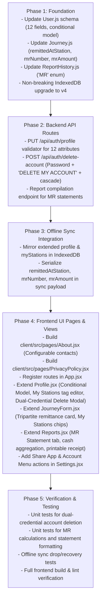

# RAILASSIST — MASTER REQUIREMENTS GAP ANALYSIS

**Document:** `docs/RAILASSIST_REQUIREMENTS_GAP_ANALYSIS.md`  
**Project:** RailAssist (Offline-First Railway Employee Platform)  
**Workspace Root:** `C:\Users\ashal\.gemini\antigravity\scratch\railassist`  
**Date Generated:** 2026-11-05  
**Version:** 2.1 (Updated with Confirmed Decisions, Dual-Credential Deletion, Tripartite MR Fields, and Pending Scope)  
**Audit Baseline:** Master Requirements Specification (`docs/RAILASSIST_MASTER_REQUIREMENTS.md`)  
**Strict Scope Rule:** Requirements documentation only. No application source code, databases, or storage modified.

---

## EXECUTIVE SUMMARY

This document provides a comprehensive, requirement-by-requirement gap analysis of the **RailAssist** application. It maps every requirement captured in the Consolidated Master Specification against the current codebase implementation state as of Git commit `52bc36e` (Tag: `phase-2.5-complete`).

### Key Audit Findings:
1. **Core Duty & Allowances (TA, NDA, Diary):** The foundational duty logging, offline IndexedDB storage, cloud sync, and 7th Central Pay Commission (CPC) TA/NDA calculation engines are solid, highly optimized, and tested.
2. **Extended Employee Profile:** Currently, `server/models/User.js` and `client/src/pages/Profile.jsx` only capture basic credentials (`name`, `email`, `password`, `role`, `division`). All 12 screenshot-derived railway profile fields (`designation`, `model`, `branch`, `zone`, `hqStation`, `level`, `basicPay`, `payScale`, `gradePay`, `billUnit`, `dateOfAppointment`, `myStations`) are missing from backend schemas and frontend forms.
3. **Confirmed Architectural Decisions:**
   - **Support Contacts:** Configurable; pending user-provided official phone and email (no placeholders or RailLog data copied).
   - **Conditional Model Field:** Model is conditional on employee designation/role (traction class for running crew; commercial link/cadre for TTEs; not forced on all staff; specific options pending clarification).
   - **Money Receipt (MR) Tripartite Fields:** Captures `mrNumber`, `mrAmount`, and `remittedAtStation` consistently across all architectural layers.
   - **Dual-Credential Account Deletion:** Requires BOTH current password verification and the exact typed phrase `DELETE MY ACCOUNT`, executing cascading deletion with audit logging.
4. **Account Menu & Supporting Pages:** The Account Menu lacks functional destinations: native Web Share integration (`Share App`), an official `About RailAssist` page (`/about`), a `Privacy Policy` page (`/privacy-policy`), and the dual-credential `Delete Account` cascade workflow.
5. **Money Receipt (MR) Statements:** Commercial ticket-checking staff collect excess fares and penalty fees on trains and remit them at station booking/cash offices. The current application has no fields for "Remitted At Station", "MR Number", or "MR Amount", and the report engine currently only compiles TA, NDA, and Diary statements.
6. **Sidebar UI Stubs:** Several sidebar routes (`/calendar`, `/allowances`, `/train-directory`, `/templates`, `/help`) remain cosmetic placeholders invoking browser `alert()` popups.

---

## 1. CONFIRMED ARCHITECTURAL DECISIONS & DECISION LOG

| Decision ID | Domain Area | Technical Specification & Scope | Decision Status |
| :--- | :--- | :--- | :---: |
| **DEC-01** | **Support Contacts** | WhatsApp support contact and Support email are marked as **Pending User-Provided Official Details**. Both channels must be configurable via environment variables (`VITE_SUPPORT_WHATSAPP`, `VITE_SUPPORT_EMAIL`) or dynamic app config. Under no circumstances should contact details be copied from RailLog or invented with dummy production values. | **Confirmed / Configurable** |
| **DEC-02** | **Conditional Model Field** | The `model` field in the Employee Profile must be **conditional based on employee designation/role**. For running crew (Loco Pilot, Assistant Loco Pilot), it must support locomotive/traction equipment classes (e.g. WAP-7, WAG-9, EMU, Diesel/Electric). For commercial staff (TTE, TC), guards, station superintendents, or inspectors, it must support relevant domain categories (e.g. Squad/Link/Cadre or remain hidden/optional). Locomotive models must **never** be forced on non-running staff. Specific designation-specific options are marked as pending clarification. | **Confirmed / Clarification Pending** |
| **DEC-03** | **Money Receipt (MR) Tripartite Fields** | All three remittance fields are mandatory across data models, backend APIs, offline storage/sync, duty form inputs, and MR statement generation: 1. **MR Number** (`mrNumber`): Cash remittance receipt number. 2. **MR Amount** (`mrAmount`): Cash collected from excess fares/penalties (₹). 3. **Remitted At Station** (`remittedAtStation`): Station code where funds were deposited. | **Confirmed** |
| **DEC-04** | **Dual-Credential Account Deletion** | Self-service account deletion strictly requires **BOTH**: 1. Current account password verification (`bcrypt.compare`). 2. Exact typed confirmation phrase: `DELETE MY ACCOUNT`. Enforces secure cascading deletion (purging journeys, reports, templates, followed by the user document), strict multi-tenant authorization (`req.user.id`), audit log creation (`USER_ACCOUNT_DELETED`) prior to purge, and explicit confirmation/error feedback. | **Confirmed** |

---

## 2. REQUIREMENT CLASSIFICATION SYSTEM

| Code | Status Label | Technical Definition |
| :---: | :--- | :--- |
| **A** | **Fully Implemented & Verified** | Code is complete across frontend, backend, and database; verified with passing automated test assertions. |
| **B** | **Implemented (Needs Functional Verification)** | Code is implemented in both frontend and backend, but lacks comprehensive end-to-end browser/user interaction testing. |
| **C** | **Partially Implemented** | Subset of functionality exists (e.g., backend API exists but frontend is unwired, or form exists but misses key fields). |
| **D** | **UI Stub Only** | User interface element exists (e.g. sidebar navigation link), but triggers a placeholder `alert()` or dummy modal with no backing route or logic. |
| **E** | **Not Implemented** | Feature was explicitly requested or discussed, but zero code, routes, schemas, or UI components exist. |
| **F** | **Needs Clarification** | Requirement contains domain ambiguities or operational definitions needing user confirmation before building. |

---

## 3. REQUIREMENT-BY-REQUIREMENT GAP ANALYSIS

### MODULE 1: EXTENDED EMPLOYEE PROFILE & "MY STATIONS" MANAGEMENT

---

#### PRF-01: Full Name & Designation
- **Classification:** **C** (Partially Implemented)
- **Source:** Screenshot Directive (2026-11-05) & Prompt 1
- **Requirement Type:** Explicit User Requirement
- **Affected Components:**
  - Frontend: `client/src/pages/Profile.jsx`
  - Backend: `server/models/User.js`, `server/index.js` (`PUT /api/auth/profile`)
  - Storage: MongoDB `users` collection, IndexedDB `RailAssistDB.profile`
- **Current State:**
  - `server/models/User.js` stores `name` and `role` (enum of 9 generic roles).
  - `client/src/pages/Profile.jsx` allows editing `name`, but designation is displayed as a disabled input derived from `user.role` via `getFullTitle()`.
- **Missing Work & Blockers:**
  - Add explicit `designation` field to `User` schema allowing users to input specific official titles (e.g., "Senior Travelling Ticket Examiner - In-charge", "Loco Pilot Passenger").
  - Update `PUT /api/auth/profile` controller to accept and persist `designation`.
  - Replace read-only designation input in `Profile.jsx` with an editable input field.
  - Sync updated designation to local IndexedDB `profile` store.
- **Dependencies:** None.

---

#### PRF-02: Conditional Operating Model & Branch / Department
- **Classification:** **E** (Not Implemented)
- **Source:** Screenshot Directive (2026-11-05) & Confirmed Decision DEC-02
- **Requirement Type:** Explicit User Requirement
- **Affected Components:**
  - Frontend: `client/src/pages/Profile.jsx`
  - Backend: `server/models/User.js`, `server/index.js` (`PUT /api/auth/profile`)
  - Storage: MongoDB `users` collection, IndexedDB `RailAssistDB.profile`
- **Current State:**
  - Neither `model` nor `branch` exists in any schema or view.
- **Missing Work & Blockers:**
  - **Conditional Model Logic (DEC-02):**
    - The Model field must dynamically adapt based on employee designation/role.
    - For Running Staff (Loco Pilot, Assistant Loco Pilot): Provide traction/locomotive class options (e.g., WAP-7, WAG-9, WAP-5, WDG-4, EMU/MEMU).
    - For Commercial Staff (TTE, TC, Commercial Inspector): Provide commercial link/cadre options (e.g., Flying Squad, Sleeper Link, Mail/Express Link, Station Duty Cadre).
    - For other staff categories: Do not force locomotive models; provide category-relevant choices or make the field optional/hidden.
    - Specific designation-to-option sets are cataloged as pending user clarification (see Section 7).
  - Add `model` (String, optional) and `branch` (String, enum: Operating, Commercial, Mechanical, Electrical, Civil, Signal & Telecom) to `UserSchema`.
  - Update `PUT /api/auth/profile` endpoint to persist both fields.
  - Implement conditional UI rendering in `Profile.jsx` updating model options based on selected role/designation.
  - Cache fields locally in IndexedDB `profile` store.
- **Dependencies:** PRF-01.

---

#### PRF-03: Railway Zone & Division Code
- **Classification:** **C** (Partially Implemented)
- **Source:** Screenshot Directive (2026-11-05) & Prompt 1, 33
- **Requirement Type:** Explicit User Requirement
- **Affected Components:**
  - Frontend: `client/src/pages/Profile.jsx`, `client/src/components/Sidebar.jsx`
  - Backend: `server/models/User.js`, `server/models/Division.js`, `server/index.js`
  - Storage: MongoDB `users` and `divisions` collections, IndexedDB `profile`
- **Current State:**
  - `server/models/User.js` has a `division` field (String, e.g. "BCT").
  - `Sidebar.jsx` uses a hardcoded client helper `getRailwayZone(division)` to guess the zone from the division code.
  - The official Railway Zone (e.g. WR, CR, NR, SR, ECoR) is NOT stored in the database.
- **Missing Work & Blockers:**
  - Add `zone` (String, e.g. "WR", "CR") to `UserSchema`.
  - Update `PUT /api/auth/profile` to accept and validate `zone`.
  - Add Zone selector/input to `Profile.jsx` alongside Division.
  - Update `Sidebar.jsx` to render the user's explicit stored Zone rather than hardcoded heuristics.
- **Dependencies:** PRF-01.

---

#### PRF-04: Headquarters Station Code (`hqStation`)
- **Classification:** **E** (Not Implemented)
- **Source:** Screenshot Directive (2026-11-05)
- **Requirement Type:** Explicit User Requirement
- **Affected Components:**
  - Frontend: `client/src/pages/Profile.jsx`, `client/src/pages/JourneyForm.jsx`
  - Backend: `server/models/User.js`, `server/index.js` (`PUT /api/auth/profile`)
  - Storage: MongoDB `users` collection, IndexedDB `RailAssistDB.profile`
- **Current State:**
  - No headquarters station code exists on the user model.
  - In `JourneyForm.jsx`, "Departure from HQ" and "Arrival at HQ" timestamps exist, but the physical HQ station code itself is not defined anywhere.
- **Missing Work & Blockers:**
  - Add `hqStation` (String, uppercase, e.g. "MMCT", "NDLS", "BBS") to `UserSchema`.
  - Update profile update endpoint to accept `hqStation`.
  - Add HQ Station input with uppercase formatting in `Profile.jsx`.
  - Automatically default duty log "From Station" or "Departure Station" to `hqStation` when logging new shifts.
- **Dependencies:** PRF-01.

---

#### PRF-05: Pay Hierarchy (Pay Level, Basic Pay, Pay Scale, Grade Pay)
- **Classification:** **E** (Not Implemented)
- **Source:** Screenshot Directive (2026-11-05)
- **Requirement Type:** Explicit User Requirement
- **Affected Components:**
  - Frontend: `client/src/pages/Profile.jsx`, `client/src/pages/Reports.jsx`
  - Backend: `server/models/User.js`, `server/models/AllowanceRule.js`, `server/index.js`
  - Storage: MongoDB `users` collection, IndexedDB `RailAssistDB.profile`
- **Current State:**
  - Allowance rates (TA/NDA) are currently tied solely to `role` via `AllowanceRule.js`.
  - None of the 7th/6th CPC financial fields (`level`, `basicPay`, `payScale`, `gradePay`) exist in `User.js` or `Profile.jsx`.
- **Missing Work & Blockers:**
  - Add financial fields to `UserSchema`:
    - `level`: String/Number (e.g., "Level 6", "Level 7").
    - `basicPay`: Number (₹).
    - `payScale`: String (e.g., "9300-34800").
    - `gradePay`: Number (₹, e.g., 4200).
  - Update `PUT /api/auth/profile` controller with numeric validation.
  - Add financial attributes section to `Profile.jsx`.
  - Inject `basicPay` and `level` into generated TA/NDA/MR statement headers in `Reports.jsx`.
- **Dependencies:** PRF-01.

---

#### PRF-06: Administrative Metadata (Bill Unit Number, Date of Appointment)
- **Classification:** **E** (Not Implemented)
- **Source:** Screenshot Directive (2026-11-05)
- **Requirement Type:** Explicit User Requirement
- **Affected Components:**
  - Frontend: `client/src/pages/Profile.jsx`, `client/src/pages/Reports.jsx`
  - Backend: `server/models/User.js`, `server/index.js`
  - Storage: MongoDB `users` collection, IndexedDB `RailAssistDB.profile`
- **Current State:**
  - Neither Bill Unit Number (salary ledger allocation) nor Date of Appointment exists in the system.
- **Missing Work & Blockers:**
  - Add `billUnit`: String (e.g., "0104821") to `UserSchema`.
  - Add `dateOfAppointment`: Date to `UserSchema`.
  - Add inputs to `Profile.jsx`.
  - Include `billUnit` in official PDF/Print statement headers.
- **Dependencies:** PRF-01.

---

#### PRF-07: "My Stations" Management
- **Classification:** **E** (Not Implemented)
- **Source:** Screenshot Directive (2026-11-05)
- **Requirement Type:** Explicit User Requirement
- **Affected Components:**
  - Frontend: `client/src/pages/Profile.jsx`, `client/src/pages/Settings.jsx`
  - Backend: `server/models/User.js`, `server/index.js` (`PUT /api/auth/profile`)
  - Storage: MongoDB `users.myStations` array, IndexedDB `RailAssistDB.profile`
- **Current State:**
  - Zero code exists for user-specific favorite/frequent stations.
- **Missing Work & Blockers:**
  - Add `myStations`: `[{ type: String, uppercase: true, trim: true }]` to `UserSchema`.
  - Build interactive "My Stations" tag-management component in `Profile.jsx`:
    - Add station code (validates 2–5 uppercase letters).
    - Remove station code badge with `×`.
    - Prevent duplicates.
  - Save `myStations` array to server and mirror to IndexedDB `profile` store.
- **Dependencies:** PRF-01.

---

#### PRF-08: Profile Form Population & Header Integration
- **Classification:** **C** (Partially Implemented)
- **Source:** Screenshot Directive (2026-11-05) & Prompt 33
- **Requirement Type:** Explicit User Requirement
- **Affected Components:**
  - Frontend: `client/src/pages/JourneyForm.jsx`, `client/src/pages/Reports.jsx`
  - Storage: IndexedDB `RailAssistDB.profile`
- **Current State:**
  - `Reports.jsx` injects `user.name`, `user.role`, and `user.division` into statement summary metadata and printable headers.
  - `JourneyForm.jsx` does not auto-populate HQ or default stations from profile.
- **Missing Work & Blockers:**
  - In `Reports.jsx`, expand printable statement header blocks to render: Designation, Zone, Division, Bill Unit No, Pay Level, and Basic Pay.
  - In `JourneyForm.jsx`, auto-fill `departureStation` with `user.hqStation` for new journeys when blank.
- **Dependencies:** PRF-01, PRF-03, PRF-04, PRF-05, PRF-06.

---

#### PRF-09: "My Stations" Quick Selection Chips
- **Classification:** **E** (Not Implemented)
- **Source:** Screenshot Directive (2026-11-05)
- **Requirement Type:** Explicit User Requirement
- **Affected Components:**
  - Frontend: `client/src/pages/JourneyForm.jsx`
  - Storage: IndexedDB `RailAssistDB.profile`
- **Current State:**
  - `JourneyForm.jsx` stations are plain text inputs (`departureStation`, `arrivalStation`).
- **Missing Work & Blockers:**
  - In `JourneyForm.jsx`, read `myStations` from `useAuth()` or IndexedDB.
  - Render clickable station chips underneath:
    1. "From Station"
    2. "To Station"
    3. "Remitted At Station"
  - Clicking a chip immediately sets that field's value without requiring manual typing.
- **Dependencies:** PRF-07, DTY-02.

---

### MODULE 2: ACCOUNT MENU & APPLICATION NAVIGATION

---

#### ACC-01: Home Navigation Action
- **Classification:** **A** (Fully Implemented & Verified)
- **Source:** Screenshot Directive (2026-11-05)
- **Requirement Type:** Explicit User Requirement
- **Affected Components:**
  - Frontend: `client/src/components/Sidebar.jsx`, `client/src/components/BottomNav.jsx`
- **Current State:**
  - Fully implemented. Sidebar brand logo and "Dashboard" nav item route to `/`. BottomNav contains home icon navigating to `/`.
- **Missing Work & Blockers:** None.
- **Dependencies:** None.

---

#### ACC-02: Profile Navigation Action
- **Classification:** **A** (Fully Implemented & Verified)
- **Source:** Screenshot Directive (2026-11-05) & Prompt 32
- **Requirement Type:** Explicit User Requirement
- **Affected Components:**
  - Frontend: `client/src/pages/Settings.jsx`, `client/src/App.jsx`
- **Current State:**
  - Fully implemented. `Settings.jsx` links to `/profile`. App route `<Route path="/profile" element={<ProtectedRoute><Profile /></ProtectedRoute>} />` is active.
- **Missing Work & Blockers:** None.
- **Dependencies:** None.

---

#### ACC-03: Share App Action (Native Web Share API)
- **Classification:** **E** (Not Implemented)
- **Source:** Screenshot Directive (2026-11-05)
- **Requirement Type:** Explicit User Requirement
- **Affected Components:**
  - Frontend: `client/src/pages/Settings.jsx` (or reusable Account Menu dropdown)
- **Current State:**
  - No share button or Web Share API integration exists in the application.
- **Missing Work & Blockers:**
  - Add "Share App" entry in `Settings.jsx` (and Account Menu).
  - Implement handler using `navigator.share({ title: 'RailAssist', text: 'Manage railway duty logs, TA/NDA allowances, and duty diaries offline with RailAssist.', url: window.location.origin })`.
  - Implement graceful clipboard copy fallback (`navigator.clipboard.writeText`) with a toast notification when `navigator.share` is unavailable.
- **Dependencies:** None.

---

#### ACC-04: About Page Navigation Action
- **Classification:** **E** (Not Implemented)
- **Source:** Screenshot Directive (2026-11-05)
- **Requirement Type:** Explicit User Requirement
- **Affected Components:**
  - Frontend: `client/src/App.jsx`, `client/src/pages/About.jsx`, `client/src/components/Sidebar.jsx`, `client/src/pages/Settings.jsx`
- **Current State:**
  - No `/about` route exists in `App.jsx`.
  - No `About.jsx` page exists.
- **Missing Work & Blockers:**
  - Create `client/src/pages/About.jsx` (see Module 3).
  - Register route `/about` in `App.jsx`.
  - Add "About RailAssist" navigation link in `Settings.jsx` and replace dummy "Help" alert in `Sidebar.jsx`.
- **Dependencies:** ABT-01 through ABT-06.

---

#### ACC-05: Privacy Policy Navigation Action
- **Classification:** **E** (Not Implemented)
- **Source:** Screenshot Directive (2026-11-05)
- **Requirement Type:** Explicit User Requirement
- **Affected Components:**
  - Frontend: `client/src/App.jsx`, `client/src/pages/PrivacyPolicy.jsx`, `client/src/pages/Settings.jsx`
- **Current State:**
  - No `/privacy-policy` route exists in `App.jsx`.
  - No `PrivacyPolicy.jsx` view exists.
- **Missing Work & Blockers:**
  - Create `client/src/pages/PrivacyPolicy.jsx` detailing offline-first local data retention, optional cloud backup, and zero third-party commercial data sharing.
  - Register `/privacy-policy` route in `App.jsx`.
  - Add "Privacy Policy" navigation item in `Settings.jsx` and `About.jsx`.
- **Dependencies:** None.

---

#### ACC-06: Dual-Credential Account Deletion Action
- **Classification:** **E** (Not Implemented)
- **Source:** Screenshot Directive (2026-11-05) & Confirmed Decision DEC-04
- **Requirement Type:** Explicit User Requirement
- **Affected Components:**
  - Frontend: `client/src/pages/Profile.jsx`, `client/src/contexts/AuthContext.jsx`
  - Backend: `server/index.js` (`POST /api/auth/delete-account`)
  - Storage: MongoDB cascade deletion (`User`, `Journey`, `ReportHistory`, `JourneyTemplate`), IndexedDB complete purge
- **Current State:**
  - `Profile.jsx` contains a "Purge Offline Cache" button, but NO account deletion capability exists.
  - No backend endpoint exists for user account self-deletion.
- **Missing Work & Blockers:**
  - **Backend Implementation (`POST /api/auth/delete-account`):**
    - Enforce multi-tenant authentication (`authenticateToken`).
    - Require request body containing `{ password, confirmationPhrase }`.
    - Validate typed phrase: strictly require `confirmationPhrase === 'DELETE MY ACCOUNT'`; return 400 with descriptive error if mismatched.
    - Validate password: re-authenticate user password via `bcrypt.compare(password, user.password)`; return 401 with descriptive error if invalid.
    - Write an immutable audit log entry: `AuditLog.create({ userId, action: 'USER_ACCOUNT_DELETED', details: 'User self-service account deletion executed', ipAddress: req.ip })` **before** document deletion.
    - Perform secure cascading deletion:
      - `Journey.deleteMany({ userId: req.user.id })`
      - `ReportHistory.deleteMany({ userId: req.user.id })`
      - `JourneyTemplate.deleteMany({ userId: req.user.id })`
      - `User.findByIdAndDelete(req.user.id)`
    - Return 200 `{ success: true, message: 'Account and associated records successfully deleted' }`.
  - **Frontend UI Modal in `Profile.jsx`:**
    - High-visibility red alert card explaining permanent data loss and cascading removal.
    - Password input field (masked).
    - Phrase input field with explicit label: *Type "DELETE MY ACCOUNT" to confirm*.
    - Submit button disabled until current password is entered AND phrase exactly matches.
    - On success: execute `localDB.clear('journeys')`, `localDB.clear('templates')`, `localDB.clear('reports')`, `localDB.clear('profile')`, flush JWT token, and navigate to `/login`.
- **Dependencies:** None.

---

### MODULE 3: ABOUT SCREEN, DISCLAIMERS & SUPPORT CHANNELS

---

#### ABT-01: Application Overview & Mission
- **Classification:** **E** (Not Implemented)
- **Source:** Screenshot Directive (2026-11-05)
- **Requirement Type:** Explicit User Requirement
- **Affected Components:**
  - Frontend: `client/src/pages/About.jsx`
- **Current State:**
  - `About.jsx` does not exist.
- **Missing Work & Blockers:**
  - Build `About.jsx` layout matching the SaaS dark-mode enterprise theme (`app-container`, `card-saas`).
  - Add comprehensive overview section highlighting offline duty management, 7th CPC allowance automation, and zero-connectivity field resilience.
- **Dependencies:** None.

---

#### ABT-02: Key Features Showcase
- **Classification:** **E** (Not Implemented)
- **Source:** Screenshot Directive (2026-11-05)
- **Requirement Type:** Explicit User Requirement
- **Affected Components:**
  - Frontend: `client/src/pages/About.jsx`
- **Current State:**
  - Not implemented.
- **Missing Work & Blockers:**
  - Implement responsive feature cards in `About.jsx`:
    1. **Daily Duty Diary:** Instant logging of running shifts, train numbers, and delay logs.
    2. **Automated Allowances:** Accurate 7th CPC TA and NDA calculation with midnight crossover handling.
    3. **Money Receipt (MR) Statements:** Fast cash remittance tracking for commercial staff.
    4. **Offline First Architecture:** Full operation without internet connection via IndexedDB.
    5. **AI Vision & Audit:** Duty slip scanning and compliance overlap verification.
- **Dependencies:** ABT-01.

---

#### ABT-03: Independent Application Disclaimer
- **Classification:** **E** (Not Implemented)
- **Source:** Screenshot Directive (2026-11-05)
- **Requirement Type:** Explicit User Requirement
- **Affected Components:**
  - Frontend: `client/src/pages/About.jsx`, `client/src/pages/Login.jsx` footer
- **Current State:**
  - No official non-affiliation disclaimer exists in the UI.
- **Missing Work & Blockers:**
  - Add high-visibility, legal disclaimer callout card in `About.jsx`:
    > *"RailAssist is an independent utility application developed to assist Indian Railways staff with duty record management and allowance computations. RailAssist is NOT affiliated with, sponsored by, or endorsed by the Ministry of Railways, the Government of India, the Centre for Railway Information Systems (CRIS), or Indian Railway Catering and Tourism Corporation (IRCTC)."*
- **Dependencies:** ABT-01.

---

#### ABT-04: Dynamic Semantic Version Display
- **Classification:** **E** (Not Implemented)
- **Source:** Screenshot Directive (2026-11-05)
- **Requirement Type:** Explicit User Requirement
- **Affected Components:**
  - Frontend: `client/src/pages/About.jsx`, `client/package.json`
- **Current State:**
  - Version is only statically declared in `package.json` ("1.0.0").
- **Missing Work & Blockers:**
  - Expose application version via Vite (`__APP_VERSION__` in `vite.config.js` or direct import from `package.json`).
  - Render badge in `About.jsx`: e.g. `Version 2.5.0 (Build 2026.11.05) • PWA Active`.
- **Dependencies:** ABT-01.

---

#### ABT-05: Configurable WhatsApp Direct Support Channel
- **Classification:** **E** (Not Implemented)
- **Source:** Screenshot Directive (2026-11-05) & Confirmed Decision DEC-01
- **Requirement Type:** Explicit User Requirement
- **Affected Components:**
  - Frontend: `client/src/pages/About.jsx`, `client/.env`
- **Current State:**
  - No WhatsApp support link exists.
- **Missing Work & Blockers:**
  - Mark official support number as **Pending User-Provided Official Details**.
  - Configure dynamic resolution via environment variable `VITE_SUPPORT_WHATSAPP` or config file.
  - Do NOT copy RailLog's contact number or invent dummy contact numbers.
  - If configured, render button linking to `https://wa.me/<number>?text=<encoded_text>`; if unconfigured, display *Support channel opening soon*.
- **Dependencies:** DEC-01.

---

#### ABT-06: Configurable Email Direct Support Channel
- **Classification:** **E** (Not Implemented)
- **Source:** Screenshot Directive (2026-11-05) & Confirmed Decision DEC-01
- **Requirement Type:** Explicit User Requirement
- **Affected Components:**
  - Frontend: `client/src/pages/About.jsx`, `client/.env`
- **Current State:**
  - No support email link exists.
- **Missing Work & Blockers:**
  - Mark official support email as **Pending User-Provided Official Details**.
  - Configure dynamic resolution via environment variable `VITE_SUPPORT_EMAIL` or config file.
  - Do NOT copy RailLog's email or invent dummy email addresses.
  - If configured, render button linking to `mailto:<email>?subject=RailAssist%20Support%20Request`; if unconfigured, display *Support channel opening soon*.
- **Dependencies:** DEC-01.

---

### MODULE 4: STATEMENTS & REPORTS GENERATION (TA, NDA, DIARY, MR)

---

#### REP-01: Travelling Allowance (TA) Statement
- **Classification:** **A** (Fully Implemented & Verified)
- **Source:** Prompt 1, 34
- **Requirement Type:** Explicit User Requirement
- **Affected Components:**
  - Frontend: `client/src/pages/Reports.jsx`
  - Backend: `server/models/AllowanceRule.js`, `server/utils/calculations.js`
- **Current State:**
  - Fully implemented and verified. Calculates 24h absence blocks and 7th CPC remainder slabs (30%, 70%, 100%) against employee role daily rate. Verified with unit and integration tests.
- **Missing Work & Blockers:** None.
- **Dependencies:** None.

---

#### REP-02: Night Duty Allowance (NDA) Statement
- **Classification:** **A** (Fully Implemented & Verified)
- **Source:** Prompt 1, 34, Phase 2.2
- **Requirement Type:** Explicit User Requirement
- **Affected Components:**
  - Frontend: `client/src/pages/Reports.jsx`
  - Backend: `server/index.js`, `server/utils/calculations.js`
- **Current State:**
  - Fully implemented. Computes elapsed duty hours between 22:00 and 06:00 IST using strict timezone-aware calculation with 5-minute increments. Tested and verified in Phase 2.2 and 2.5.
- **Missing Work & Blockers:** None.
- **Dependencies:** None.

---

#### REP-03: Daily Duty Diary Statement
- **Classification:** **A** (Fully Implemented & Verified)
- **Source:** Prompt 1, 34 & Screenshot Directive
- **Requirement Type:** Explicit User Requirement
- **Affected Components:**
  - Frontend: `client/src/pages/Reports.jsx`
  - Backend: `server/models/ReportHistory.js`
- **Current State:**
  - Fully implemented. Chronological tabular view of shifts, train numbers, stations, delays, and duty notes. Printable and exportable to CSV.
- **Missing Work & Blockers:** None.
- **Dependencies:** None.

---

#### REP-04: Money Receipt (MR) Remittance Statement
- **Classification:** **E** (Not Implemented)
- **Source:** Screenshot Directive (2026-11-05) & Confirmed Decision DEC-03
- **Requirement Type:** Explicit User Requirement
- **Affected Components:**
  - Frontend: `client/src/pages/Reports.jsx`
  - Backend: `server/models/ReportHistory.js`, `server/models/Journey.js`
  - Storage: MongoDB `ReportHistory.reportType` enum, IndexedDB `reports`
- **Current State:**
  - `server/models/ReportHistory.js` schema defines: `enum: ['TA', 'NDA', 'DIARY']`.
  - `client/src/pages/Reports.jsx` only provides tab selectors for TA, NDA, and DIARY.
  - Zero MR aggregation or remittance statement generation exists.
- **Missing Work & Blockers:**
  - Update `server/models/ReportHistory.js` to include `'MR'` in `reportType` enum.
  - Add MR tab option in `Reports.jsx` (`'MR'`).
  - Add table view for MR compilation aggregating all three tripartite fields:
    - Shift Date & Train Number
    - **MR Number** (`mrNumber`)
    - **MR Amount** (`mrAmount` in ₹)
    - **Remitted At Station** (`remittedAtStation`)
    - Remarks / Cashier Reference
  - Calculate total remitted cash (`totalMRAmount`) for the selected month.
  - Add CSV export format for MR remittance statements.
  - Add printable A4 container layout for MR remittance statements with booking office cashier signature block.
- **Dependencies:** DTY-02, PRF-08, DEC-03.

---

#### REP-05: Pre-Submission Compliance Audit
- **Classification:** **A** (Fully Implemented & Verified)
- **Source:** Prompt 5, 34
- **Requirement Type:** Explicit User Requirement
- **Affected Components:**
  - Backend: `server/routes/aiAudit.js`, `server/controllers/aiAuditController.js`
  - Frontend: `client/src/pages/Reports.jsx`
- **Current State:**
  - Fully implemented. Detects sequence overlaps, negative durations, and station discontinuity. Generates a health score (0–100%) and AI compliance feedback. Warns user if generating statements with health score < 70%.
- **Missing Work & Blockers:** None.
- **Dependencies:** None.

---

#### REP-06: Spreadsheet Export (CSV)
- **Classification:** **A** (Fully Implemented & Verified)
- **Source:** Prompt 1, DEC-03
- **Requirement Type:** Explicit User Requirement
- **Affected Components:**
  - Frontend: `client/src/pages/Reports.jsx` (`handleExportCSV`)
- **Current State:**
  - Fully implemented. Client-side CSV generation with UTF-8 BOM encoding for TA, NDA, and Diary reports.
- **Missing Work & Blockers:**
  - Extend CSV export to handle the new `'MR'` statement format, including columns for Train Number, Date, MR Number, MR Amount (₹), and Remitted At Station.
- **Dependencies:** REP-04.

---

#### REP-07: Print Preview Container
- **Classification:** **A** (Fully Implemented & Verified)
- **Source:** Prompt 1, 34
- **Requirement Type:** Explicit User Requirement
- **Affected Components:**
  - Frontend: `client/src/pages/Reports.jsx` (`PrintPreviewContainer`)
- **Current State:**
  - Fully implemented with dedicated `@media print` CSS rules, high-contrast formatting, and employee/supervisor signature blocks.
- **Missing Work & Blockers:**
  - Add MR printable layout sheet with Cash Office / Booking Supervisor signature block.
- **Dependencies:** REP-04.

---

#### REP-08: Server-Side Binary PDF Generation
- **Classification:** **E** (Not Implemented)
- **Source:** Prompt 1
- **Requirement Type:** Explicit User Requirement
- **Affected Components:**
  - Backend: `server/routes/reports.js` (does not exist), `server/controllers/reportController.js` (does not exist)
- **Current State:**
  - The app relies entirely on client-side browser printing (`window.print()`).
  - No server-side binary PDF generation engine (e.g. PDFKit or Puppeteer) exists.
- **Missing Work & Blockers:**
  - Requires headless PDF generation engine on the server if true binary downloadable PDFs are needed without opening browser print dialogs.
- **Dependencies:** None (Optional feature if client print is accepted as sufficient).

---

#### REP-09: Statement Archival & History Log
- **Classification:** **A** (Fully Implemented & Verified)
- **Source:** Prompt 1, Phase 2.3
- **Requirement Type:** Explicit User Requirement
- **Affected Components:**
  - Backend: `server/models/ReportHistory.js`, `server/index.js`
  - Frontend: `client/src/pages/Reports.jsx`
  - Storage: MongoDB `reporthistories` collection (indexed by `{ userId: 1, month: 1 }` and `{ userId: 1, generatedAt: -1 }`), IndexedDB `reports`
- **Current State:**
  - Fully implemented. Statements are saved to MongoDB and mirrored locally in IndexedDB. Users can view past generated reports.
- **Missing Work & Blockers:**
  - Ensure MR reports are archived with `reportType: 'MR'` and `totalAmount: totalMRAmount`.
- **Dependencies:** REP-04.

---

### MODULE 5: DUTY LOGGING, STATIONS & CORE CRUD

---

#### DTY-01: Shift Creation, Editing & Deletion
- **Classification:** **A** (Fully Implemented & Verified)
- **Source:** Prompt 1, 16
- **Requirement Type:** Explicit User Requirement
- **Affected Components:**
  - Frontend: `client/src/pages/JourneyForm.jsx`, `client/src/pages/Journeys.jsx`
  - Backend: `server/models/Journey.js`, `server/index.js`
- **Current State:**
  - Fully functional. All standard fields (train number, name, stations, scheduled/actual departure/arrival, distance, notes) are persisted and calculated.
- **Missing Work & Blockers:** None.
- **Dependencies:** None.

---

#### DTY-02: Remittance Details (`remittedAtStation`, `mrNumber`, `mrAmount`)
- **Classification:** **E** (Not Implemented)
- **Source:** Screenshot Directive (2026-11-05) & Confirmed Decision DEC-03
- **Requirement Type:** Explicit User Requirement
- **Affected Components:**
  - Frontend: `client/src/pages/JourneyForm.jsx`, `client/src/pages/Journeys.jsx`
  - Backend: `server/models/Journey.js`, `server/index.js`
  - Storage: MongoDB `journeys` collection, IndexedDB `RailAssistDB.journeys`
- **Current State:**
  - Neither `remittedAtStation` nor `mrNumber` nor `mrAmount` exists in `Journey.js` or `JourneyForm.jsx`.
- **Missing Work & Blockers:**
  - Add fields to `server/models/Journey.js`:
    - `remittedAtStation`: String (uppercase, trim)
    - `mrNumber`: String (trim)
    - `mrAmount`: Number (default: 0, min: 0)
  - Update `JourneyForm.jsx` with a dedicated "Cash Remittance Details (TTE / Commercial)" section:
    - Remitted At Station input (with "My Stations" suggestion chips)
    - MR Number input
    - MR Amount (₹) numeric input
  - Display "Remitted At", "MR #", and "MR Amount (₹)" in duty details modal in `Journeys.jsx`.
  - Update sync payload serialization in `JourneyContext.jsx`.
- **Dependencies:** DEC-03.

---

#### DTY-03: Train Autocomplete & Directory Lookups
- **Classification:** **A** (Fully Implemented & Verified)
- **Source:** Prompt 1, 16
- **Requirement Type:** Explicit User Requirement
- **Affected Components:**
  - Frontend: `client/src/pages/JourneyForm.jsx`
  - Backend: `server/index.js` (`GET /api/trains?q=`), `server/models/Train.js`
- **Current State:**
  - Fully implemented. Typing 2+ characters queries `trains` collection or local IndexedDB cache, automatically populating Train Name, From Station, To Station, and Distance.
- **Missing Work & Blockers:** None.
- **Dependencies:** None.

---

#### DTY-04: Multi-Tenant Scoped Data Isolation
- **Classification:** **A** (Fully Implemented & Verified)
- **Source:** Prompt 1, Phase 2.3
- **Requirement Type:** Explicit User Requirement
- **Affected Components:**
  - Backend: `server/index.js`, `server/repositories/JourneyRepository.js`
- **Current State:**
  - Fully implemented and verified. All CRUD queries filter strictly by `{ userId: req.user.id }`.
- **Missing Work & Blockers:** None.
- **Dependencies:** None.

---

#### DTY-05: High-Density Table with Sticky Headers & Sorting
- **Classification:** **A** (Fully Implemented & Verified)
- **Source:** Prompt 34
- **Requirement Type:** Explicit User Requirement
- **Affected Components:**
  - Frontend: `client/src/pages/Journeys.jsx`
- **Current State:**
  - Fully implemented. High-density dark UI with sticky header, multi-column sorting (Date, Train, Distance, TA, NDA), search filter, and sync status pills.
- **Missing Work & Blockers:** None.
- **Dependencies:** None.

---

#### DTY-06: Server-Side Query Pagination
- **Classification:** **E** (Not Implemented)
- **Source:** Prompt 34, Phase 1 Audit
- **Requirement Type:** Assistant Recommendation
- **Affected Components:**
  - Backend: `server/index.js` (`GET /api/journeys`)
  - Frontend: `client/src/contexts/JourneyContext.jsx`
- **Current State:**
  - `GET /api/journeys` returns all records for the user without pagination.
- **Missing Work & Blockers:**
  - Add optional `?page=1&limit=50` query parameters to backend route while preserving non-paginated batch sync endpoints.
- **Dependencies:** None.

---

#### DTY-07: Global Keyboard Shortcut (Ctrl+N / Cmd+N)
- **Classification:** **A** (Fully Implemented & Verified)
- **Source:** Prompt 32
- **Requirement Type:** Explicit User Requirement
- **Affected Components:**
  - Frontend: `client/src/pages/Dashboard.jsx`
- **Current State:**
  - Implemented in `Dashboard.jsx` via global `keydown` event listener.
- **Missing Work & Blockers:** None.
- **Dependencies:** None.

---

### MODULE 6: OFFLINE-FIRST PWA, INDEXEDDB & SYNCHRONIZATION

---

#### PWA-01: Offline Shift Creation & Persistence
- **Classification:** **A** (Fully Implemented & Verified)
- **Source:** Prompt 0, 1
- **Requirement Type:** Explicit User Requirement
- **Affected Components:**
  - Frontend: `client/src/services/db.js`, `client/src/contexts/JourneyContext.jsx`
- **Current State:**
  - Fully implemented. Duties can be created, updated, and deleted while completely offline.
- **Missing Work & Blockers:** None.
- **Dependencies:** None.

---

#### PWA-02: Client-Generated `localId` UUIDs
- **Classification:** **A** (Fully Implemented & Verified)
- **Source:** Prompt 1, Phase 2.3
- **Requirement Type:** Explicit User Requirement
- **Affected Components:**
  - Frontend: `client/src/contexts/JourneyContext.jsx`
  - Backend: `server/models/Journey.js`
- **Current State:**
  - Fully implemented. `crypto.randomUUID()` generates unique IDs on the client; MongoDB enforces sparse unique index `{ userId: 1, localId: 1 }`.
- **Missing Work & Blockers:** None.
- **Dependencies:** None.

---

#### PWA-03: Idempotent Batch Cloud Sync with Remittance Fields
- **Classification:** **A** (Fully Implemented & Verified)
- **Source:** Prompt 0, Phase 2.3, DEC-03
- **Requirement Type:** Explicit User Requirement
- **Affected Components:**
  - Backend: `server/index.js` (`POST /api/journeys/sync`)
  - Frontend: `client/src/contexts/JourneyContext.jsx`
- **Current State:**
  - Fully implemented. Auto-syncs on `window.addEventListener('online')` and manual "Sync Now" button.
- **Missing Work & Blockers:**
  - Ensure new tripartite fields (`remittedAtStation`, `mrNumber`, `mrAmount`) are explicitly serialized in batch sync payload.
- **Dependencies:** DTY-02, DEC-03.

---

#### PWA-04: Service Worker HTTP Method Safety
- **Classification:** **A** (Fully Implemented & Verified)
- **Source:** Phase 2.5 Audit
- **Requirement Type:** Assistant Recommendation
- **Affected Components:**
  - Frontend: `client/public/sw.js`
- **Current State:**
  - Fully hardened in Phase 2.5. Filters `event.request.method === 'GET'` before touching Cache API.
- **Missing Work & Blockers:** None.
- **Dependencies:** None.

---

#### PWA-05: Offline SPA Navigation Fallback
- **Classification:** **A** (Fully Implemented & Verified)
- **Source:** Phase 2.5 Audit
- **Requirement Type:** Assistant Recommendation
- **Affected Components:**
  - Frontend: `client/public/sw.js`
- **Current State:**
  - Fully implemented. Catches failed navigation requests and serves cached `/index.html`.
- **Missing Work & Blockers:** None.
- **Dependencies:** None.

---

#### PWA-06: Build-Time Workbox Precache Manifest
- **Classification:** **E** (Not Implemented)
- **Source:** Prompt 0, Phase 2.5 Audit
- **Requirement Type:** Assistant Recommendation
- **Affected Components:**
  - Frontend: `client/vite.config.js`, `client/public/sw.js`
- **Current State:**
  - `sw.js` uses a static array `STATIC_ASSETS = ['/', '/index.html', '/logo.svg']` which does not track Vite's content-hashed production JS/CSS asset filenames.
- **Missing Work & Blockers:**
  - Configure `vite-plugin-pwa` or a build script to generate and inject the exact bundle filenames into the precache list.
- **Dependencies:** None.

---

#### PWA-07: Offline Binary Duty Slip Photo Queuing
- **Classification:** **A** (Fully Implemented & Verified)
- **Source:** Prompt 6
- **Requirement Type:** Explicit User Requirement
- **Affected Components:**
  - Frontend: `client/src/services/db.js`, `client/src/contexts/JourneyContext.jsx`
- **Current State:**
  - Fully implemented. Raw image blobs are saved to IndexedDB `photos` store and dispatched upon network reconnection.
- **Missing Work & Blockers:** None.
- **Dependencies:** None.

---

### MODULE 7: AI AUTOMATION & SMART WORKFLOWS

---

#### AI-01: Smart Duty Slip OCR Parser
- **Classification:** **B** (Implemented, Needs Functional Verification)
- **Source:** Prompt 5, 6
- **Requirement Type:** Explicit User Requirement
- **Affected Components:**
  - Backend: `server/routes/aiOcr.js`, `server/workers/ocrWorker.js`
  - Frontend: `client/src/pages/JourneyForm.jsx`
- **Current State:**
  - Code is implemented with Gemini Flash multimodal vision parser and worker thread fallback.
- **Missing Work & Blockers:**
  - Real-world verification against physical Indian Railways duty slips and running room chits.
- **Dependencies:** Active `GEMINI_API_KEY`.

---

#### AI-02: Voice Duty Dictation
- **Classification:** **C** (Partially Implemented)
- **Source:** Prompt 5
- **Requirement Type:** Explicit User Requirement
- **Affected Components:**
  - Frontend: `client/src/pages/JourneyForm.jsx` (`webkitSpeechRecognition`)
- **Current State:**
  - Browser Web Speech API (`webkitSpeechRecognition`) is wired to the "Duty Notes" textarea.
- **Missing Work & Blockers:**
  - Only populates free-text notes; does not parse voice commands into discrete train numbers or dates.
- **Dependencies:** Browser microphone support.

---

#### AI-03: Voice Natural Language Intent Parsing
- **Classification:** **C** (Partially Implemented)
- **Source:** Prompt 5, 6
- **Requirement Type:** Explicit User Requirement
- **Affected Components:**
  - Backend: `server/routes/aiVoice.js`
  - Frontend: `client/src/pages/JourneyForm.jsx`
- **Current State:**
  - Backend route `POST /api/ai/voice/parse` exists and uses Gemini to parse sentences like *"Started from Surat at 10 PM on train 12952 to Mumbai"*.
  - The frontend is NOT wired to this endpoint (only dictation to notes is wired).
- **Missing Work & Blockers:**
  - Connect the microphone button on the duty form to send transcript to `/api/ai/voice/parse` and auto-fill form inputs.
- **Dependencies:** AI-02.

---

#### AI-04: RAG AI Copilot Assistant Modal
- **Classification:** **A** (Fully Implemented & Verified)
- **Source:** Prompt 5, 6, 7
- **Requirement Type:** Explicit User Requirement
- **Affected Components:**
  - Frontend: `client/src/components/AIChatModal.jsx`
  - Backend: `server/routes/aiChat.js`
- **Current State:**
  - Fully implemented and functional. Grounded in user's shift history via MongoDB aggregation with navigation actions.
- **Missing Work & Blockers:** None.
- **Dependencies:** None.

---

#### AI-05: Smart Form Context Suggestions
- **Classification:** **E** (Not Implemented)
- **Source:** Prompt 5
- **Requirement Type:** Explicit User Requirement
- **Affected Components:**
  - Frontend: `client/src/pages/JourneyForm.jsx`
- **Current State:**
  - Not implemented. Form fields start blank unless selecting a template.
- **Missing Work & Blockers:**
  - Predict return leg train number and return station from the user's latest logged journey.
- **Dependencies:** None.

---

#### AI-06: Delay Reason Prediction
- **Classification:** **E** (Not Implemented)
- **Source:** Prompt 5, 6
- **Requirement Type:** Explicit User Requirement
- **Affected Components:**
  - Backend: `server/routes/aiPrediction.js`
- **Current State:**
  - Not implemented.
- **Missing Work & Blockers:**
  - ML/heuristic model correlating section, time of day, and weather to common railway delays (signals, track maintenance).
- **Dependencies:** None.

---

#### AI-07: Intelligent Proactive Duty Reminders
- **Classification:** **E** (Not Implemented)
- **Source:** Prompt 5
- **Requirement Type:** Explicit User Requirement
- **Affected Components:**
  - Frontend: `client/src/pages/Notifications.jsx`, `client/public/sw.js`
- **Current State:**
  - `Notifications.jsx` is a static UI view; no background scheduled reminder triggers exist.
- **Missing Work & Blockers:**
  - Background Service Worker push or local notification schedule alerting staff if shift arrival is past due without sign-off.
- **Dependencies:** None.

---

### MODULE 8: SIDEBAR NAVIGATION & SUBSCRIPTION BUSINESS

---

#### NAV-01: Duty Roster Calendar (`/calendar`)
- **Classification:** **D** (UI Stub Only)
- **Source:** Prompt 32, 34
- **Requirement Type:** Explicit User Requirement
- **Affected Components:**
  - Frontend: `client/src/components/Sidebar.jsx`
- **Current State:**
  - Clicking "Duty Roster" in the sidebar triggers `alert('Duty Roster is under construction.')`.
- **Missing Work & Blockers:**
  - Build monthly calendar grid view rendering scheduled shifts, rest days, and off-duty periods.
  - Register `/calendar` route in `App.jsx`.
- **Dependencies:** None.

---

#### NAV-02: Allowances Matrix Screen (`/allowances`)
- **Classification:** **D** (UI Stub Only)
- **Source:** Prompt 32
- **Requirement Type:** Explicit User Requirement
- **Affected Components:**
  - Frontend: `client/src/components/Sidebar.jsx`
- **Current State:**
  - Clicking "Allowances Matrix" triggers `alert('Allowances Matrix is under construction.')`.
- **Missing Work & Blockers:**
  - Create interactive reference table showing official 7th CPC daily TA rates and hourly NDA rates across all 9 railway roles.
  - Register `/allowances` route in `App.jsx`.
- **Dependencies:** None.

---

#### NAV-03: Official Train Directory (`/train-directory`)
- **Classification:** **D** (UI Stub Only)
- **Source:** Prompt 32, 34
- **Requirement Type:** Explicit User Requirement
- **Affected Components:**
  - Frontend: `client/src/components/Sidebar.jsx`
- **Current State:**
  - Clicking "Train Directory" triggers `alert('Official Train Directory is under construction.')`.
- **Missing Work & Blockers:**
  - Build searchable, paginated directory table browsing Indian Railways trains, routes, and intermediate stops.
  - Register `/train-directory` route in `App.jsx`.
- **Dependencies:** None.

---

#### NAV-04: Statement Templates Screen (`/templates`)
- **Classification:** **D** (UI Stub Only)
- **Source:** Prompt 32, 34
- **Requirement Type:** Explicit User Requirement
- **Affected Components:**
  - Frontend: `client/src/components/Sidebar.jsx`
- **Current State:**
  - Clicking "Statement Templates" triggers `alert('Statement Templates are under construction.')`.
  - Backend model `JourneyTemplate.js` and IndexedDB `templates` store already exist, but there is no standalone dedicated page.
- **Missing Work & Blockers:**
  - Build template manager UI allowing users to create, preview, edit, and delete recurring route templates.
  - Register `/templates` route in `App.jsx`.
- **Dependencies:** None.

---

#### NAV-05: Admin Analytics Console (`/admin/analytics`)
- **Classification:** **E** (Not Implemented)
- **Source:** Prompt 1
- **Requirement Type:** Explicit User Requirement
- **Affected Components:**
  - Frontend: `client/src/pages/admin/Analytics.jsx`
- **Current State:**
  - Admin dashboard (`/admin`) and user manager (`/admin/users`) exist, but system-wide disbursement analytics screen is missing.
- **Missing Work & Blockers:**
  - Aggregate TA/NDA totals across divisions for administrative review.
- **Dependencies:** None.

---

#### NAV-06: Commercial Subscriptions & Tier Gating
- **Classification:** **C** (Partially Implemented)
- **Source:** Prompt 1
- **Requirement Type:** Explicit User Requirement
- **Affected Components:**
  - Backend: `server/models/Subscription.js`, `server/models/User.js`
  - Frontend: `client/src/pages/Settings.jsx`
- **Current State:**
  - Data models and tier badges exist ("Free", "Premium", "Enterprise"), but live payment gateway integration (Razorpay/Stripe) is not wired.
- **Missing Work & Blockers:**
  - Razorpay checkout integration and webhook subscription lifecycle listeners.
- **Dependencies:** Payment gateway API credentials.

---

## 4. SUMMARY MATRIX & STATISTICS

### Status Code Distribution Across All Modules:

| Module | Total Reqs | A (Verified) | B (Needs Verif) | C (Partial) | D (UI Stub) | E (Missing) | F (Needs Clarif) |
| :--- | :---: | :---: | :---: | :---: | :---: | :---: | :---: |
| **1. Extended Profile & My Stations** | 9 | 0 | 0 | 3 | 0 | 6 | 0 |
| **2. Account Menu & Navigation** | 6 | 2 | 0 | 0 | 0 | 4 | 0 |
| **3. About Page, Disclaimers & Support** | 6 | 0 | 0 | 0 | 0 | 6 | 0 |
| **4. Statements & Reports (TA/NDA/Diary/MR)** | 9 | 6 | 0 | 0 | 0 | 3 | 0 |
| **5. Duty Logging, Stations & Core CRUD** | 7 | 5 | 0 | 0 | 0 | 2 | 0 |
| **6. Offline PWA, IndexedDB & Sync** | 7 | 6 | 0 | 0 | 0 | 1 | 0 |
| **7. AI Automation & Smart Workflows** | 7 | 1 | 1 | 2 | 0 | 3 | 0 |
| **8. Sidebar Navigation & Subscriptions** | 6 | 0 | 0 | 1 | 4 | 1 | 0 |
| **TOTALS** | **57** | **20** | **1** | **6** | **4** | **26** | **0** |

### Implementation Progress Breakdown:
- **Fully Implemented & Verified (A):** 20 / 57 (35.1%)
- **Functional Implementation Complete (A + B):** 21 / 57 (36.8%)
- **Partially Implemented (C):** 6 / 57 (10.5%)
- **UI Stubs (D):** 4 / 57 (7.0%)
- **Not Implemented (E):** 26 / 57 (45.6%)

---

## 5. EXPLICIT USER REQUIREMENTS VS. ASSISTANT RECOMMENDATIONS

### Explicit User Requirements (53 Items):
- **Profile & Stations:** PRF-01, PRF-02, PRF-03, PRF-04, PRF-05, PRF-06, PRF-07, PRF-08, PRF-09
- **Account Menu:** ACC-01, ACC-02, ACC-03, ACC-04, ACC-05, ACC-06
- **About Page & Channels:** ABT-01, ABT-02, ABT-03, ABT-04, ABT-05, ABT-06
- **Reports & Statements:** REP-01, REP-02, REP-03, REP-04, REP-05, REP-06, REP-07, REP-08, REP-09
- **Duty Logging & CRUD:** DTY-01, DTY-02, DTY-03, DTY-04, DTY-05, DTY-07
- **Offline PWA:** PWA-01, PWA-02, PWA-03, PWA-07
- **AI Automations:** AI-01, AI-02, AI-03, AI-04, AI-05, AI-06, AI-07
- **Navigation & SaaS:** NAV-01, NAV-02, NAV-03, NAV-04, NAV-05, NAV-06

### Assistant / Engineering Recommendations (4 Items):
- **DTY-06:** Server-Side Query Pagination (`?page=1&limit=50` on `GET /api/journeys` to protect low-end mobile devices).
- **PWA-04:** Service Worker HTTP Method Safety (`event.request.method === 'GET'` guard).
- **PWA-05:** Offline SPA Navigation Fallback (serving cached `/index.html` on failed navigations).
- **PWA-06:** Build-Time Workbox Precache Manifest (injecting hashed production chunks into `sw.js`).

---

## 6. SAFEST IMPLEMENTATION ORDER

To introduce the missing screenshot-derived requirements and unblock partially implemented features **without breaking existing working functionality, database integrity, or offline sync**, implementation should proceed in five strict sequential phases:

### Phase 1: Foundation (Database Schemas, Types & Data Contracts)
- **Objective:** Establish data layer support for extended profile attributes and commercial remittance records before altering controllers or frontend views.
- **Changes:**
  1. Update `server/models/User.js`:
     - Add `designation` (String), `model` (String, optional/conditional), `branch` (String), `zone` (String), `hqStation` (String), `level` (String), `basicPay` (Number), `payScale` (String), `gradePay` (Number), `billUnit` (String), `dateOfAppointment` (Date), and `myStations` (`[String]`).
  2. Update `server/models/Journey.js`:
     - Add all three remittance fields: `remittedAtStation` (String), `mrNumber` (String), `mrAmount` (Number).
  3. Update `server/models/ReportHistory.js`:
     - Expand `reportType` enum to include `'MR'`.
  4. Non-breaking IndexedDB schema upgrade (`RailAssistDB` v4 in `client/src/services/db.js`):
     - Ensure existing user stores (`journeys`, `templates`, `reports`, `profile`) remain intact while supporting new fields.

### Phase 2: Backend API Routes & Business Logic
- **Objective:** Expose secure, validated endpoints for profile updates, dual-credential account deletion, and MR statement compilations.
- **Changes:**
  1. Update `PUT /api/auth/profile` in `server/index.js` to accept and validate all 12 extended profile attributes.
  2. Implement `POST /api/auth/delete-account` in `server/index.js`:
     - Validate `confirmationPhrase === 'DELETE MY ACCOUNT'` (400 if mismatched).
     - Validate password via `bcrypt.compare(password, user.password)` (401 if invalid).
     - Write audit log `USER_ACCOUNT_DELETED` prior to deletion.
     - Cascade deletion: `Journey`, `ReportHistory`, `JourneyTemplate`, and `User`.
  3. Update `GET /api/reports` and `POST /api/reports` controllers to support compilation and archival of `MR` (Money Receipt) statements with total remitted cash aggregation.

### Phase 3: Offline PWA & Data Layer Synchronization
- **Objective:** Guarantee that new fields are safely persisted offline and synchronized to MongoDB Atlas upon reconnection.
- **Changes:**
  1. Update `JourneyContext.jsx` serialization:
     - Include `remittedAtStation`, `mrNumber`, and `mrAmount` in offline queues (`pending_create`, `pending_update`).
  2. Update `AuthContext.jsx`:
     - Mirror full extended profile and `myStations` into IndexedDB `profile` store upon login and profile updates.

### Phase 4: Frontend UI Pages, Modals & Navigation
- **Objective:** Build all missing user-facing views and integrate quick-selection chips.
- **Changes:**
  1. Build `client/src/pages/About.jsx`:
     - Overview, feature showcase, independent disclaimer, semantic version, configurable WhatsApp link, and configurable support email.
  2. Build `client/src/pages/PrivacyPolicy.jsx`:
     - Clear offline data policy, local device retention, and zero third-party telemetry.
  3. Register `/about` and `/privacy-policy` routes in `client/src/App.jsx`.
  4. Extend `client/src/pages/Profile.jsx`:
     - Add sections for Railway Identity (Zone, Division, HQ, Branch, Designation).
     - Add conditional Model field adapting options based on selected role/designation.
     - Add Pay Details (Level, Basic Pay, Pay Scale, Grade Pay, Bill Unit, Appointment Date).
     - Add "My Stations" tag editor.
     - Add Dual-Credential "Delete Account" modal requiring password AND typed phrase `DELETE MY ACCOUNT`.
  5. Enhance `client/src/pages/JourneyForm.jsx`:
     - Render "My Stations" quick selection chips under "From Station", "To Station", and "Remitted At Station".
     - Add Remittance card with all 3 fields: `remittedAtStation`, `mrNumber`, `mrAmount`.
  6. Enhance `client/src/pages/Reports.jsx`:
     - Add "MR Statement" tab selector, tabular compilation, total cash calculation, and printable A4 remittance container with Cashier signature block.
  7. Add "Share App" (Web Share API) and updated links in `client/src/pages/Settings.jsx` or Account Menu.

### Phase 5: Verification, Automated Testing & Regression Protection
- **Objective:** Verify that existing 7th CPC calculations, sync pipelines, and auth workflows remain 100% intact.
- **Changes:**
  1. Add backend unit tests for profile updates.
  2. Add unit tests for dual-credential account deletion (rejecting wrong password, rejecting mismatched phrase, succeeding with cascade on both).
  3. Add unit tests for MR statement compilation and total cash summation.
  4. Verify offline IndexedDB storage and sync with simulated network drops.
  5. Run full frontend build (`npm run build`) and backend test suites (`npm test`).

---

## 7. DOMAIN CLARIFICATIONS & PENDING STATUS LOG

The following table records the status of operational domain details:

| Topic | Status | Technical Action Plan |
| :--- | :---: | :--- |
| **WhatsApp Support Number** | **Pending User Details** | Marked pending official user provision. Configurable via `VITE_SUPPORT_WHATSAPP`. No RailLog numbers or invented placeholders copied. |
| **Support Email Address** | **Pending User Details** | Marked pending official user provision. Configurable via `VITE_SUPPORT_EMAIL`. No RailLog emails or invented placeholders copied. |
| **Conditional Model Field Options** | **Partially Defined / Pending Details** | Running Staff receive locomotive classes (WAP-7, WAG-9, EMU, etc.). Commercial Staff and other designations will receive role-appropriate options once provided by the user; locomotive models will not be forced on non-running staff. |
| **Money Receipt (MR) Fields** | **CONFIRMED** | All 3 fields (`mrNumber`, `mrAmount`, `remittedAtStation`) are incorporated across all layers. |
| **Account Deletion Safeguards** | **CONFIRMED** | Requires BOTH password verification and exact typed phrase `DELETE MY ACCOUNT`, with full cascade, authorization, and audit logging. |

---

## 8. ADDITIONAL USER REQUIREMENTS – PENDING

> [!IMPORTANT]
> **Scope Notice:** The 57 requirements cataloged in this specification represent the verified baseline of historical user requests (Prompts 0–49) and initial screenshot-derived directives. **They do not constitute the final or complete application scope.**
> 
> The user has indicated that additional features, rules, and operational workflows will be provided in subsequent project stages. All existing requirements remain strictly preserved without deletion, unwarranted merging, or silent modification.

The following pending placeholders are reserved for incoming specifications:

| Pending ID | Domain / Scope Area | Description / Scope Placeholder | Status |
| :--- | :--- | :--- | :---: |
| **ADD-PEND-01** | **Official Support Contact Details** | WhatsApp support telephone number and support email address to be provided by the user. | Pending User Input |
| **ADD-PEND-02** | **Designation-Specific Model Options** | Granular role-to-model mapping sets for Commercial Staff, Operating Staff, and Supervisors. | Pending User Input |
| **ADD-PEND-03** | **Future Operational Workflows** | Additional features, validation rules, statement formats, and integrations to be specified by the user. | Pending User Input |
